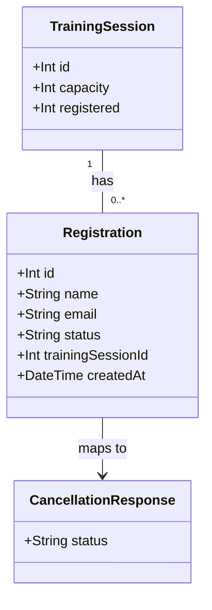

# Cancel Registration

## Requirements
Allow an employee to cancel their own training session registration using their registration ID, releasing a confirmed seat back to the session's capacity and handing off to waitlist promotion.

## Entities

Conservative note: no schema changes. `Registration.status` already supports arbitrary string values (`confirmed`, `waitlisted` exist today); this feature only adds a new value, `cancelled`, written by a new code path — no migration needed. `TrainingSession.registered` remains the existing persisted counter, decremented through the same conditional-update style already used to increment it.

## Approach
1. Endpoint Design:
   - Single endpoint `DELETE /api/training-sessions/:id/registrations/:registrationId`, nested the same way as the existing `POST /:id/registrations`, added as a sibling route in the same router file.
   - Response status communicates outcome: `200` on successful cancellation, `404` if the registration doesn't exist (or doesn't belong to `:id`), `409` if already cancelled — matching this file's existing one-status-per-outcome style.

2. Technical Implementation:
   - Extend the existing Express + Prisma + SQLite stack; no new dependencies.
   - Route layer (`api/src/routes/training-sessions.ts`) parses/validates both path params and shapes the response only, per `CLAUDE.md`'s "no Prisma calls in routes" norm — delegates to one new service function.
   - Error handling stays in line with existing routes in this file: `try/catch` per route, flat `{ error: string }` JSON body, explicit status codes. No exception-class hierarchy or global handler middleware is introduced, matching the established pattern (and the pre-existing, separately-tracked stack-trace-leaking error middleware in `app.ts` is left untouched).
   - Concurrency: the existence check, already-cancelled check, conditional `registered` decrement (only for a `confirmed` registration), and the `Registration` status update are all performed inside one `prisma.$transaction`, using a conditional `updateMany` (keyed on `Registration.status = 'confirmed'` or `'waitlisted'`, not an arithmetic floor) to make the status transition atomic and race-safe — mirroring `registerForSession`'s existing transactional shape.

3. Business Logic:
   - Core rule: cancelling a `confirmed` registration transitions it to `cancelled` AND decrements `TrainingSession.registered` by 1. Cancelling a `waitlisted` registration transitions it to `cancelled` but does NOT touch `registered` (no seat was ever counted for it). This composition is not stated explicitly in the original AC (which only describes the confirmed case) but is required for `Registration.status` to stay meaningful for waitlisted employees who want to leave the waitlist, and is called out in the saved analysis's Risk & Gap section as the recommended reading.
   - Validation order: registration existence AND `:id`/`:registrationId` pairing (404) → already-cancelled check (409) → status-specific transition (confirmed→decrement+cancel, or waitlisted→cancel only).
   - A registration row whose `trainingSessionId` does not match the `:id` path param is treated as "not found" (404) — same resource-not-found semantic as an unknown `registrationId`, no new status code introduced.
   - Waitlist promotion (WH-5) is invoked as an explicit, separately-named trigger call after a successful cancellation of a row that was `confirmed` — see Operations for its exact (minimal) shape. Cancelling a `waitlisted` registration does not trigger promotion (nothing freed up).

## Structure

### Inheritance Relationships
1. No new interfaces, abstract classes, or exception hierarchies — same as the existing registration feature, errors communicate via HTTP status + plain JSON body.

### Dependencies
1. `training-sessions.ts` route calls `cancelRegistration` (new function in `trainingSessionService.ts`) — zero direct `prisma.*` calls in the route.
2. `trainingSessionService.ts`'s `cancelRegistration` depends on `prisma` (existing singleton from `api/src/lib/prisma.ts`), same as `registerForSession`.
3. `cancelRegistration` calls `promoteFromWaitlist` (new, minimal trigger function, same file) only when a `confirmed` registration was cancelled — this is the WH-5 seam; `promoteFromWaitlist` itself is a narrow no-op placeholder for this story (see Operations), not WH-5's implementation.
4. `TrainingSessionCard.tsx` (frontend) depends on a new `fetch` call (`DELETE` method) to the new endpoint, following the existing inline-`fetch`-per-component pattern already used for registration — no shared API client introduced.

### Layered Architecture
1. Route Layer (`api/src/routes/training-sessions.ts`): parses `id` and `registrationId` params, calls the service, maps the result to the correct HTTP status/body. No validation beyond numeric-param checks, no Prisma calls.
2. Service Layer (`api/src/services/trainingSessionService.ts`): owns all business logic — registration lookup + pairing check, already-cancelled guard, transactional status transition + conditional decrement, and invoking the promotion trigger. Returns a plain discriminated result object to the route.
3. Data Access: Prisma Client via the existing singleton, inside a single `$transaction` block for the write path.
4. Error Handling: inline `try/catch` in the route handler, consistent with existing routes.

## Operations

### Implement Service Function — cancelRegistration
1. Interface Definition: `cancelRegistration(sessionId: number, registrationId: number): Promise<CancellationResult>` where `CancellationResult` is a discriminated union: `{ status: 'not_found' } | { status: 'already_cancelled' } | { status: 'cancelled' }`.
2. Core Methods:
   - Input Validation: none at this layer — numeric-ness of `sessionId`/`registrationId` is guaranteed by the route before this function is called.
   - Business Logic:
     - Open `prisma.$transaction`.
     - Inside the transaction: `tx.registration.findUnique({ where: { id: registrationId } })`. If null, or if `registration.trainingSessionId !== sessionId`, return `{ status: 'not_found' }` immediately (no further side effects).
     - If `registration.status === 'cancelled'`, return `{ status: 'already_cancelled' }` immediately (no further side effects).
     - If `registration.status === 'confirmed'`: run a conditional `tx.registration.updateMany({ where: { id: registrationId, status: 'confirmed' }, data: { status: 'cancelled' } })`. If `count === 1` (this request won the transition — guards a concurrent double-cancel), then `tx.trainingSession.update({ where: { id: sessionId }, data: { registered: { decrement: 1 } } })`, then call `promoteFromWaitlist(tx, sessionId)`. If `count === 0` (a concurrent request already cancelled it first), return `{ status: 'already_cancelled' }`.
     - If `registration.status === 'waitlisted'`: run the same conditional `updateMany` keyed on `status: 'waitlisted'` instead of `'confirmed'`. If `count === 1`, do NOT decrement `registered` and do NOT call `promoteFromWaitlist`. If `count === 0`, return `{ status: 'already_cancelled' }`.
     - On a successful transition (either branch), return `{ status: 'cancelled' }`.
3. Dependency Injection: imports `prisma` singleton directly, same convention as `registerForSession`.
4. Transaction Management: the entire lookup-through-decrement-through-promotion-trigger sequence is one `prisma.$transaction` call, matching `registerForSession`'s existing boundary (one transaction per registration state change).

### Implement Service Function — promoteFromWaitlist (WH-5 seam, minimal)
1. Responsibility: explicit, named integration point that WH-4's cancellation flow calls after freeing a confirmed seat — WH-5 will later fill in the actual promotion algorithm here. For this story, it is a documented no-op: it performs no data mutation.
2. Interface Definition: `promoteFromWaitlist(tx: Prisma.TransactionClient, sessionId: number): Promise<void>`.
3. Core Methods:
   - Logic for this story: function body only, no call sites changed — returns immediately. A one-line code comment states this is the WH-5 trigger point and does not implement promotion logic, so a future WH-5 implementer (or a REASONS Canvas run for WH-5) has an unambiguous place to add it.
   - Must accept the same `tx` (transaction client) used by `cancelRegistration`, not a fresh `prisma` call, so that when WH-5 fills this in, the promotion write naturally joins the same atomic transaction as the cancellation — this constrains WH-5's future transaction boundary without building WH-5's logic now.
4. Constraints: this function must be called (not merely exist) from the `confirmed`-cancellation branch of `cancelRegistration`, so the AC's "waitlist promotion is triggered" is satisfied structurally and is testable (a unit test can assert the function was invoked).

### Add Route — DELETE /:id/registrations/:registrationId
1. Responsibility: parse both path params, delegate to `cancelRegistration`, map result to HTTP response.
2. Methods:
   - Logic:
     - Parse `id` and `registrationId` via `parseInt(..., 10)`; if either is `NaN`, respond `400 { error: 'Invalid session ID' }` or `400 { error: 'Invalid registration ID' }` respectively — matching the existing `isNaN` guard style used by `GET /:id` and `POST /:id/registrations`.
     - Call `cancelRegistration(id, registrationId)`.
     - If result status is `not_found`, respond `404 { error: 'Registration not found' }`.
     - If result status is `already_cancelled`, respond `409 { error: 'Registration already cancelled' }`.
     - If result status is `cancelled`, respond `200 { status: 'cancelled' }`.
     - Wrap the whole handler body in `try/catch`; on unexpected error, `console.error` and respond `500 { error: 'Failed to cancel registration' }`, matching the existing routes' catch-all shape.
3. Constraints: must not import or call `prisma` directly in this file (team norm) — only calls into `trainingSessionService.ts`.

### Update Frontend Component — TrainingSessionCard
1. Responsibility: offer a "Cancel Registration" action once the employee holds a `confirmed` or `waitlisted` `result` from the existing post-registration flow, confirm, call the DELETE endpoint, and reflect the outcome.
2. Attributes (new local state):
   - `cancelled: boolean` — tracks whether the current `result` has been cancelled this session, defaults `false`.
   - `cancelError: string | null` — surfaces a cancellation-specific error separately from the existing registration `error` state.
3. Methods:
   - `handleCancel(): Promise<void>`
     - Logic:
       - Guard: do nothing if `!result` or `cancelled` is already `true`.
       - Show a confirmation prompt via `window.confirm(\`Are you sure you want to cancel your registration for ${session.title}?\`)`; if the user declines, return without calling the API.
       - On confirm, call `fetch(\`/api/training-sessions/${session.id}/registrations/${result.id}\`, { method: 'DELETE' })`.
       - On `200`, set `cancelled` to `true` and clear `cancelError`.
       - On non-`200` (`404`/`409`/other), set `cancelError` from the response body's `error` field (or a fallback message), leave `cancelled` as `false`.
4. Rendering changes:
   - When `result && !cancelled`: render a "Cancel Registration" button beneath the existing confirmation/waitlist message.
   - When `result && cancelled`: replace the confirmation message with "Your registration has been cancelled" and do not render the Cancel button (per AC: hidden once already cancelled). Also recompute and display the session's updated registered/capacity count — achieved by re-fetching the parent session list/detail after a successful cancellation (exact refetch mechanism — lifting state up or a page-level refetch callback passed as a prop — is left to match whatever data-fetching pattern the session's parent page (`app/src/pages`) already uses; do not introduce a new global state library for this).
   - If `cancelError` is set, render it near the Cancel button, following the same inline-error style already used for `error` in the registration form.
5. Constraints: no new UI library, no new routing — stays within the existing inline-state, inline-`fetch` component pattern.

## Norms
1. Annotation Standards: none — this codebase uses plain TypeScript functions/interfaces, no decorator-based annotations anywhere (Express + Prisma, not a decorator-driven framework). Do not introduce any.
2. Dependency Injection: constructor/decorator DI does not apply here; continue the existing convention of importing the `prisma` singleton directly in service-layer files only.
3. Exception Handling:
   - No custom exception classes or hierarchy — this codebase communicates business outcomes via discriminated-union return values from service functions (`RegistrationResult`, and now `CancellationResult`), not thrown exceptions, mapped to HTTP status in the route layer.
   - Unexpected/unanticipated errors are caught per-route with `try/catch`, logged via `console.error`, and returned as a flat `{ error: string }` body with `500` — matching every existing route in `training-sessions.ts`.
   - Do not add a `GlobalExceptionHandler`-style middleware; none exists in this codebase and introducing one is out of scope for this story.
4. Data Validation: numeric path-param validation via `parseInt` + `isNaN` check at the route layer, same as `GET /:id` and `POST /:id/registrations`. No validation library (e.g. Zod, Joi) is used anywhere in this codebase; do not introduce one for this story.
5. Logging: `console.error` on unexpected (500) errors only, matching existing routes — no structured/leveled logging exists in this codebase.
6. Documentation Standards: no JSDoc/TSDoc convention exists in `trainingSessionService.ts` or `training-sessions.ts` today; match that — rely on discriminated-union type names and short inline comments only where a non-obvious invariant needs explaining (e.g., the `promoteFromWaitlist` seam comment), not on function-level doc comments.

## Safeguards
1. Functional Constraints: `DELETE /:id/registrations/:registrationId` must return exactly one of `200`/`400`/`404`/`409`/`500` per the Approach/Operations above; no other status code is acceptable. Cancelling a registration must never decrement `TrainingSession.registered` below `0` and must never decrement it for a `waitlisted`-origin cancellation.
2. Performance Constraints: the cancellation transaction must complete in a single `prisma.$transaction` round-trip (one lookup, one conditional update, one optional decrement, one optional promotion-trigger call) — no additional queries beyond what's specified in Operations.
3. Security Constraints: no authentication is added (matches existing `POST /:id/registrations`); the registration ID remains the sole access token, per the story's explicit "Out of Scope." Do not log `name`/`email` values in any new `console.error` call (only log generic error context, e.g. the caught error object, as existing routes already do).
4. Integration Constraints: must not alter `registerForSession`, `getAllSessions`, or `getSessionById`'s existing signatures or behavior. Must not introduce any new npm dependency. Must not modify `api/prisma/schema.prisma` (no new fields/models needed — `status: 'cancelled'` is just a new string value for the existing column).
5. Business Rule Constraints: a `confirmed`-to-`cancelled` transition must always pair with exactly one `registered` decrement, atomically, within the same transaction — verified by: two concurrent cancel requests for the same registration must result in exactly one `200` and one `409`, never two `200`s and never a double decrement. A `waitlisted`-to-`cancelled` transition must never touch `registered` and must never call `promoteFromWaitlist`.
6. Exception Handling Constraints: unexpected errors must return `500 { error: string }` with no stack trace or internal detail in the body (the route's own `try/catch`, not the global `app.ts` error middleware, should handle all anticipated failure modes here so the global handler's stack-trace-leaking behavior is never hit by this feature's normal operation).
7. Technical Constraints: no Prisma calls (`prisma.*` or `$queryRaw*`) in `api/src/routes/training-sessions.ts` for the new route — service-layer only, per `CLAUDE.md`. No `any` type anywhere in new code (per `CLAUDE.md` team norm) — `CancellationResult` and all function signatures must be fully typed, including `Prisma.TransactionClient` for `promoteFromWaitlist`'s `tx` parameter.
8. Data Constraints: `registrationId` and `sessionId` path params must be validated as parseable positive integers before any service call; a non-numeric value is a `400`, not a `404` or `500`.
9. API Constraints: endpoint path and method are fixed as specified by the AC: `DELETE /api/training-sessions/:id/registrations/:registrationId`. Success response body is exactly `{ status: "cancelled" }` with no additional fields, matching the AC verbatim.
