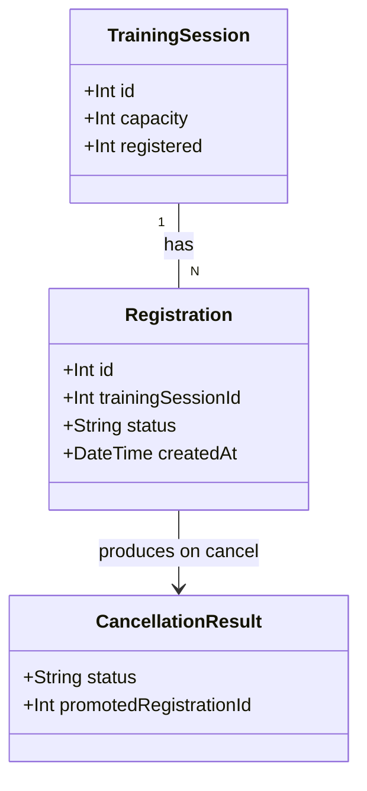

# Promote First Waitlisted Employee After Cancellation

## Requirements
Automatically fill a seat vacated by a confirmed cancellation with the longest-waiting employee on that session's waitlist, atomically and invisibly to the cancelling employee, so no open seat sits unused while a waitlisted employee is still waiting.

## Entities

No new entities, no schema changes. `Registration.status` remains an unconstrained `String` (`confirmed` | `waitlisted` | `cancelled`); `promotedRegistrationId` is a response-shape field only, not a persisted column.

## Approach
1. **Promotion algorithm location**:
   - Implement the entire promotion algorithm inside the existing `promoteFromWaitlist(tx, sessionId)` seam in `api/src/services/trainingSessionService.ts` — no new route, no new service entry point, no schema change.
   - `promoteFromWaitlist` owns both the "find the oldest waitlisted registration" lookup and the "flip it to confirmed" mutation; callers only pass `sessionId`.

2. **Technical implementation**:
   - Widen `promoteFromWaitlist`'s return type from `Promise<void>` to `Promise<number | null>` — the promoted registration's `id`, or `null` if nothing was promoted.
   - Widen `CancellationResult`'s `cancelled` variant to `{ status: 'cancelled'; promotedRegistrationId: number | null }`. Always populate this field on every `cancelled` result (including the `waitlisted`-cancellation branch, where it is always `null`) — one consistent shape, not one that varies by which branch produced it.
   - Route layer (`api/src/routes/training-sessions.ts`) surfaces `promotedRegistrationId` in the existing `200 { status: 'cancelled' }` JSON body — no new status codes, no new route.
   - Everything happens inside the single `prisma.$transaction` that WH-4's `cancelRegistration` already opens; `promoteFromWaitlist` must keep using the passed-in `tx: Prisma.TransactionClient`, never a bare `prisma.*` call or a second transaction.

3. **Business logic**:
   - **`registered` arithmetic (the single most load-bearing decision)**: a `waitlisted` registration was never counted in `registered` (only the `confirmed` branch of `registerForSession` increments it). `cancelRegistration`'s confirmed-origin branch already unconditionally decrements `registered` by 1 before calling `promoteFromWaitlist`. When a promotion succeeds, `promoteFromWaitlist` must increment `registered` by 1 to restore the seat the decrement just released — net effect across cancel+promote is zero relative to the pre-cancellation value. This is what makes AC "registered count stays the same" literally true. If no promotion occurs, `registered` stays decremented by 1 (AC: "no promotion occurs, registered count decrements by 1").
   - **FIFO ordering**: promote the `waitlisted` registration for `sessionId` with the earliest `createdAt`; tiebreak by `id` ascending for determinism on timestamp collisions.
   - **Call-site constraint preserved from WH-4**: `promoteFromWaitlist` is invoked only from the `confirmed`-cancellation branch of `cancelRegistration`, never the `waitlisted`-cancellation branch — do not relax this.
   - **Race safety**: promotion uses a read (`findFirst`) then a conditional write (`updateMany` keyed on `id` + `status: 'waitlisted'`), mirroring WH-4's own conditional-`updateMany` race guard on the cancellation side. If the `updateMany` count is 0 (another concurrent transaction already promoted or cancelled that row), treat it as "no promotion happened" — not an error — and return `null`.
   - **Notification seam (AC: "notification sent to promoted employee", WH-8 out of scope)**: on a successful promotion, call a new no-op seam function `notifyPromotion(registrationId: number): void` (or `Promise<void>`), with a one-line comment marking it as the WH-8 trigger point — mirroring the `promoteFromWaitlist` no-op precedent WH-4 established. Must actually be called, not just exist.
   - **Explicitly out of scope / not addressed by this implementation** (per analysis gap): AC "promoted employee sees Confirmed after refreshing" requires a persistent per-employee registration lookup (e.g., a GET-by-registration-id endpoint + frontend `localStorage` persistence) that does not exist anywhere in this codebase and is not hinted at by this story's scope or implementation hint. This implementation makes the underlying data correct (the `Registration.status` row genuinely becomes `confirmed` in the DB) but does not add new frontend/API surface to let a returning employee look that up — flag this gap to the user again after the canvas, do not silently build speculative new endpoints to cover it.

## Structure

### Inheritance Relationships
No new classes, interfaces, or exception types. `CancellationResult` remains a discriminated union (TypeScript union type, not a class hierarchy).

### Dependencies
1. `cancelRegistration` (trainingSessionService.ts) calls `promoteFromWaitlist(tx, sessionId)` — unchanged call site, only the awaited return value changes from `void` to `number | null`.
2. `promoteFromWaitlist` calls `tx.registration.findFirst` then `tx.registration.updateMany` then `tx.trainingSession.update`, and on success calls `notifyPromotion`.
3. `routes/training-sessions.ts`'s `DELETE /:id/registrations/:registrationId` handler reads `result.promotedRegistrationId` off the `cancelled` result variant and includes it in the JSON response — no new dependency on `prisma` directly (route still never touches `prisma`/`$queryRaw*` per this repo's layering rule).

### Layered Architecture
1. Route Layer (`api/src/routes/training-sessions.ts`): parses `:id`/`:registrationId`, calls `cancelRegistration`, maps the result (including the new field) to the JSON response. No business logic, no Prisma calls.
2. Service Layer (`api/src/services/trainingSessionService.ts`): `cancelRegistration` and `promoteFromWaitlist` hold all business logic and all Prisma calls, inside one `$transaction`.
3. Data Access: Prisma Client via the existing transaction client `tx`, no raw SQL, no schema migration.

## Operations

### Update Function - `promoteFromWaitlist`
1. Responsibility: find the oldest waitlisted registration for a session and promote it to confirmed, restoring the `registered` count; return the promoted registration's id or `null`.
2. Signature: `promoteFromWaitlist(tx: Prisma.TransactionClient, sessionId: number): Promise<number | null>`
3. Logic:
   - `findFirst` on `tx.registration` where `trainingSessionId: sessionId, status: 'waitlisted'`, order by `createdAt: 'asc'` then `id: 'asc'`.
   - If no row found, return `null`.
   - Attempt `tx.registration.updateMany({ where: { id: candidate.id, status: 'waitlisted' }, data: { status: 'confirmed' } })`.
   - If `count === 0` (lost the race to a concurrent transaction), return `null` — do not retry, do not throw.
   - If `count === 1`, run `tx.trainingSession.update({ where: { id: sessionId }, data: { registered: { increment: 1 } } })`, call `notifyPromotion(candidate.id)`, and return `candidate.id`.
4. Remove the `// WH-5 trigger point` placeholder comment and the `_tx`/`_sessionId` unused-parameter prefixes now that the body is implemented.

### Update Function - `cancelRegistration`
1. Responsibility: unchanged control flow from WH-4, except the `confirmed`-origin success path now threads the promotion id into the returned result.
2. Logic change: after `await promoteFromWaitlist(tx, sessionId)` on the confirmed-cancellation branch, capture its return value and return `{ status: 'cancelled', promotedRegistrationId: <that value> }` instead of `{ status: 'cancelled' }`.
3. The `waitlisted`-cancellation branch's success path returns `{ status: 'cancelled', promotedRegistrationId: null }` — same field present, always `null` here, since `promoteFromWaitlist` is never called on this branch.

### Update Type - `CancellationResult`
1. Change the `cancelled` variant from `{ status: 'cancelled' }` to `{ status: 'cancelled'; promotedRegistrationId: number | null }`.
2. `not_found` and `already_cancelled` variants are unchanged.

### Create Function - `notifyPromotion` (no-op seam)
1. Responsibility: placeholder trigger point for WH-8's real notification delivery; structurally present, not implemented.
2. Signature: `notifyPromotion(registrationId: number): void`
3. Logic: no-op body with a one-line comment: `// WH-8 trigger point: notification delivery is not implemented yet, this is a no-op seam.`
4. Called exactly once, from `promoteFromWaitlist`, only on a successful promotion (after the `registered` increment).

### Update Route - `DELETE /:id/registrations/:registrationId`
1. On `result.status === 'cancelled'`, change the response body from `res.status(200).json({ status: 'cancelled' })` to `res.status(200).json({ status: 'cancelled', promotedRegistrationId: result.promotedRegistrationId })`.
2. `not_found` (404) and `already_cancelled` (409) branches are unchanged.

### Update Tests
1. `api/tests/unit/trainingSessionService.test.ts`: add cases for `promoteFromWaitlist` — promotes oldest waitlisted registration when one exists; returns `null` and leaves `registered` unchanged when waitlist is empty; `registered` is net-zero across a cancel(confirmed)+promote sequence; a losing `updateMany` (simulated via mock returning `count: 0`) returns `null` without throwing.
2. `api/tests/integration/training-sessions.test.ts`: extend the existing cancellation suite — cancel a confirmed registration with a non-empty waitlist asserts the response body's `promotedRegistrationId` matches the promoted registration's id, the promoted registration's `status` is `confirmed` in the DB afterward, and the session's `registered` count is unchanged from its pre-cancellation value; cancel a confirmed registration with an empty waitlist asserts `promotedRegistrationId: null` and `registered` decremented by 1; cancel a `waitlisted` registration asserts `promotedRegistrationId: null` and no change to `registered`.

## Norms
1. No `any` anywhere in new or touched code — `promoteFromWaitlist`'s parameters and return type stay fully typed (`Prisma.TransactionClient`, `number | null`).
2. No Prisma calls in route handlers — all `tx.*`/`prisma.*` access stays inside `trainingSessionService.ts`, per this repo's layering rule (`CLAUDE.md`).
3. All mutations affecting `Registration.status` or `TrainingSession.registered` happen inside the single `prisma.$transaction` already opened by `cancelRegistration` — never a second transaction, never a bare `prisma.*` call from within `promoteFromWaitlist`.
4. Conditional `updateMany` (never a bare `update`) is the required pattern for any state transition guarded against a concurrent race, matching the precedent set by both `registerForSession` and WH-4's `cancelRegistration`.
5. No new files — all changes land in the existing `trainingSessionService.ts`, `training-sessions.ts`, and their two existing test files.
6. `make lint`, `make format-check`, and `make test` must all pass before this is considered done (per `CLAUDE.md`'s team norms).

## Safeguards
1. Functional Constraints: promotion must only ever be triggered by a confirmed-origin cancellation; cancelling a waitlisted registration must never call `promoteFromWaitlist`. No new route, no manual/organiser-triggered promotion endpoint (explicitly out of scope per the story).
2. Performance Constraints: promotion adds at most one `findFirst`, one `updateMany`, and one `update` to the existing cancellation transaction — no N+1 queries, no additional round trips outside the transaction.
3. Security Constraints: no new user input is accepted by this feature (promotion is a side effect, not a new endpoint parameter) — no new validation surface beyond what WH-4's route already parses.
4. Integration Constraints: the `DELETE /:id/registrations/:registrationId` response shape change (`promotedRegistrationId` added) is additive to the WH-4 contract shipped in PR #19 — existing clients reading only `status` are unaffected; this is not a breaking change to the field's presence, only an addition.
5. Business Rule Constraints: `registered` must be numerically identical before a confirmed-cancellation-with-promotion and after it completes (net zero); `registered` must decrease by exactly 1 when a confirmed cancellation finds no one to promote. Both must be asserted by tests, not just implemented.
6. Data Constraints: no schema changes, no new columns, no new migration — `status` remains an unconstrained `String`; `promotedRegistrationId` exists only in the service return type and JSON response, never persisted.
7. API Constraints: `promotedRegistrationId` is always present (never `undefined`) on every `{ status: 'cancelled' }` response, typed as `number | null`, regardless of which cancellation branch produced it.
8. Concurrency Constraints: two concurrent confirmed-cancellations on the same session with exactly one waitlisted employee must result in exactly one promotion, not zero and not two — the losing transaction's `updateMany` must return `count: 0` and be treated as a normal "no promotion" outcome, never as a thrown error or a retry loop.
