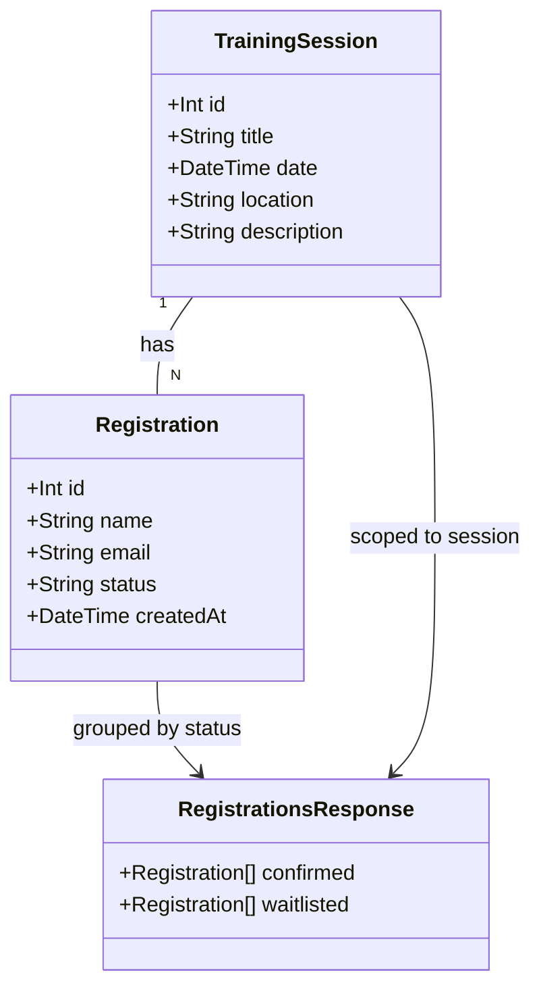

# Organiser Can View Registrations For A Session

## Requirements
Give anyone browsing WorkshopHub a dedicated session detail page that surfaces who is confirmed and who is waitlisted for a session, so training organisers can prepare for delivery and communicate with participants without needing any new access control.

## Entities


No new Prisma models or columns. `RegistrationsResponse` is a response-shape type only (service return type + route JSON body), not a persisted entity.

## Approach
1. **API design**:
   - Add one new service function `getRegistrationsForSession(sessionId: number)` in `api/src/services/trainingSessionService.ts`, following the same route → service → prisma layering already used by every endpoint in this file.
   - Add one new route, `GET /:id/registrations`, in `api/src/routes/training-sessions.ts`, placed alongside the existing `GET /:id` and `POST /:id/registrations` routes.
   - No schema changes — `Registration` already has every field the AC requires (`id`, `name`, `email`, `status`, `createdAt`).

2. **Technical implementation**:
   - Frontend introduces `react-router-dom` as a new dependency — the first routing library in this app. Installed as v7.x (API-compatible with the originally-planned v6 for this app's usage — `BrowserRouter`/`Routes`/`Route`/`Link`/`useParams` are unchanged across the major version, and v7 fully supports React 18 via its `react: '>=18'` peer range, so no React upgrade was needed). Two routes: `/` (existing `TrainingSessionsPage`, unchanged behavior) and `/sessions/:id` (new `SessionDetailPage`).
   - `App.tsx` wraps its content in `<BrowserRouter>` with a `<Routes>`/`<Route>` pair; `main.tsx` is unaffected.
   - `TrainingSessionCard` gains a dedicated "View Registrations" link (using react-router's `<Link>`, not a raw `<a>`) — a new element distinct from the existing Register/Cancel buttons, so no click-handler conflicts with the card's existing interactive children.
   - `SessionDetailPage` independently fetches both `GET /api/training-sessions/:id` (session info, reusing the existing endpoint — no backend change needed for this part) and `GET /api/training-sessions/:id/registrations` (the new endpoint) on mount — it does not rely on navigation state, so a direct URL visit or bookmarked link works correctly.

3. **Business logic**:
   - **Status filter**: the new query selects `Registration` rows where `trainingSessionId` matches and `status != 'cancelled'`, mirroring the existing `waitlistCount`'s precedent of filtering `_count` to a specific status rather than returning everything.
   - **Grouping**: the service splits the filtered rows into two arrays by `status` (`confirmed`, `waitlisted`) and returns `{ confirmed: Registration[], waitlisted: Registration[] }` — the split happens server-side, not client-side, matching the AC's framing as two independently-counted subsections.
   - **404 on missing session**: the service checks `getSessionById`-style existence before running the registrations query (or treats "session not found" and "no registrations" as distinguishable outcomes) — same existence-check pattern as the existing `GET /:id` route.
   - **Empty state**: when both `confirmed` and `waitlisted` arrays are empty, `SessionDetailPage` renders "No registrations yet" — this falls out naturally from the status filter with no special-casing needed in the query itself.
   - **404 handling on the frontend**: as implemented, `SessionDetailPage` does not render a distinct "session not found" state — a 404 from either fetch is caught and surfaces through the same generic `error` state used for any fetch failure (one "Failed to load session." page with the error message shown beneath it). This was a simplification made during generation; no separate not-found visual state exists.

## Structure

### Inheritance Relationships
No new classes or exception types. `RegistrationsResult` (service return type) is a discriminated union, matching the existing `RegistrationResult`/`CancellationResult` pattern in `trainingSessionService.ts`.

### Dependencies
1. `routes/training-sessions.ts`'s new `GET /:id/registrations` handler calls `getRegistrationsForSession` — no direct Prisma access in the route, per this repo's layering rule.
2. `getRegistrationsForSession` calls `prisma.trainingSession.findUnique` (existence check) then `prisma.registration.findMany` (the filtered/grouped query) — no transaction needed, this is read-only.
3. `App.tsx` depends on `react-router-dom`'s `BrowserRouter`/`Routes`/`Route`.
4. `SessionDetailPage` (new) depends on the existing fetch-on-mount pattern already used by `TrainingSessionsPage`, and imports `TrainingSession` and a new `RegistrationsBySession` type from `app/src/types/index.ts`.
5. `TrainingSessionCard` depends on `react-router-dom`'s `<Link>` for the new "View Registrations" navigation element.

### Layered Architecture
1. Route Layer (`api/src/routes/training-sessions.ts`): parses `:id`, calls `getRegistrationsForSession`, maps the result to JSON (200 or 404). No business logic, no Prisma calls.
2. Service Layer (`api/src/services/trainingSessionService.ts`): `getRegistrationsForSession` holds the existence check, the query, and the status-split logic.
3. Data Access: Prisma Client via the existing singleton (`lib/prisma.ts`), read-only queries, no raw SQL, no migration.
4. Frontend Page Layer: `SessionDetailPage` (new) owns its own loading/error/data state, independent of `TrainingSessionsPage`.
5. Frontend Routing Layer (new): `App.tsx` owns the `<BrowserRouter>`/`<Routes>` definition — the only place route paths are declared.

## Operations

### Create Function - `getRegistrationsForSession`
1. Responsibility: return the confirmed and waitlisted registrations for a session, excluding cancelled ones, or signal that the session doesn't exist.
2. Signature: `getRegistrationsForSession(sessionId: number): Promise<RegistrationsResult>`
3. Return type: `type RegistrationsResult = { status: 'not_found' } | { status: 'ok'; confirmed: Registration[]; waitlisted: Registration[] }`
4. Logic:
   - Check the session exists via `prisma.trainingSession.findUnique({ where: { id: sessionId } })`. If not found, return `{ status: 'not_found' }`.
   - Query `prisma.registration.findMany({ where: { trainingSessionId: sessionId, status: { not: 'cancelled' } }, orderBy: { createdAt: 'asc' } })`.
   - Split the result into `confirmed` (rows where `status === 'confirmed'`) and `waitlisted` (rows where `status === 'waitlisted'`) arrays.
   - Return `{ status: 'ok', confirmed, waitlisted }`.

### Update Route - `training-sessions.ts`
1. Add `router.get('/:id/registrations', ...)` after the existing `GET /:id` route.
2. Parse `:id` with the same `parseInt`/`isNaN` 400-check pattern already used by every other route in this file.
3. Call `getRegistrationsForSession(id)`.
4. On `not_found`, respond `404 { error: 'Training session not found' }` (same message text as the existing `GET /:id` 404).
5. On `ok`, respond `200 { confirmed: result.confirmed, waitlisted: result.waitlisted }`.
6. Wrap in the same try/catch + `console.error` + `500` pattern used by every other route in this file.

### Add Dependency - `react-router-dom`
1. Add `react-router-dom` to `app/package.json` dependencies. Installed: `^7.18.4` (v7.x, not the originally-planned 6.x — same `BrowserRouter`/`Routes`/`Route`/`Link`/`useParams` API, fully compatible with React 18 via its `react: '>=18'` peer range).
2. Regenerate the lockfile with `corepack prepare pnpm@9 --activate` before running `pnpm install` (per this repo's established CI-lockfile-version convention), then restore the sandbox's default pnpm afterward.

### Update Component - `App.tsx`
1. Wrap the existing `<main className="app-main">...</main>` content in a `<BrowserRouter>`.
2. Replace the direct `<TrainingSessionsPage />` render with:
   ```
   <Routes>
     <Route path="/" element={<TrainingSessionsPage />} />
     <Route path="/sessions/:id" element={<SessionDetailPage />} />
   </Routes>
   ```
3. Header (`<h1>WorkshopHub</h1>` etc.) stays outside the `<Routes>`, rendered on every page — no change to its current behavior.

### Create Component - `SessionDetailPage`
1. Responsibility: fetch and render a single session's full info plus its confirmed/waitlisted registrations.
2. File: `app/src/pages/SessionDetailPage.tsx` (+ matching `.css`, following the existing `TrainingSessionsPage.css` sibling-file convention).
3. Reads `:id` via `useParams<{ id: string }>()` from `react-router-dom`.
4. On mount, fetches `GET /api/training-sessions/:id` and `GET /api/training-sessions/:id/registrations` (parallel `Promise.all`, both using the same `API_BASE` constant pattern `TrainingSessionsPage` already uses).
5. State machine mirrors `TrainingSessionsPage`'s existing pattern: `loading`, `error` (covers both network failure and the session-not-found 404 case, following the existing error-state render), and loaded data.
6. Render, once loaded: existing session fields (title, date, location, description) in a layout consistent with the existing session card's meta display, followed by a "Registrations" section with two subsections, "Confirmed (N)" and "Waitlist (N)", each listing `name`, `email`, and a formatted `createdAt` per entry (reuse `TrainingSessionCard`'s existing `formatDate` logic, extracted or duplicated consistent with this repo's current lack of a shared utils module — do not introduce a new shared utils file for a two-function reuse; duplicating the two small date formatters is acceptable and matches this codebase's current size).
7. When both `confirmed` and `waitlisted` are empty arrays, render "No registrations yet" instead of the two subsections.
8. A "Back to sessions" `<Link to="/">` for returning to the list.

### Update Component - `TrainingSessionCard`
1. Add a new `<Link to={`/sessions/${session.id}`} className="session-card__view-registrations-link">View Registrations</Link>` element on the card, placed near the existing badges/header area — distinct from the Register/Cancel button area so there is no click-handler conflict.
2. No changes to the existing Register/Cancel/waitlist logic in this component.

### Update Types - `app/src/types/index.ts`
1. Add `export interface RegistrationEntry { id: number; name: string; email: string; status: 'confirmed' | 'waitlisted'; createdAt: string }`.
2. Add `export interface RegistrationsBySession { confirmed: RegistrationEntry[]; waitlisted: RegistrationEntry[] }`.

### Create Tests
1. `api/tests/unit/trainingSessionService.test.ts`: add cases for `getRegistrationsForSession` — returns `not_found` for a missing session; returns `{ confirmed: [], waitlisted: [] }` for a session with no registrations; correctly splits confirmed vs. waitlisted; excludes cancelled registrations from both arrays.
2. `api/tests/integration/training-sessions.test.ts`: add cases for `GET /:id/registrations` — 200 with both arrays populated correctly against real data; cancelled registrations excluded; 404 for a non-existent session id; response includes `name`, `email`, `status`, `createdAt` per entry.

## Norms
1. No `any` anywhere in new or touched code — `getRegistrationsForSession`'s parameters, return type, and the new frontend types are fully typed.
2. No Prisma calls in route handlers — the new route only calls `getRegistrationsForSession`, never `prisma.*` directly.
3. New frontend page and component code follows the existing inline-`fetch`-per-component pattern already used throughout `app/src` — no shared API client is introduced (confirmed absent from the codebase, per `wh-2-wh-3-registration`'s prior convention).
4. The new `GET /:id/registrations` route goes in the existing `training-sessions.ts` file, not a new route file — matches how `POST /:id/registrations` and `DELETE /:id/registrations/:registrationId` are already colocated there.
5. CSS for `SessionDetailPage` follows the existing per-component `.css` sibling-file convention (`SessionDetailPage.tsx` + `SessionDetailPage.css`), matching `TrainingSessionsPage.tsx`/`.css` and `TrainingSessionCard.tsx`/`.css`.
6. `make lint`, `make format-check`, and `make test` must all pass before this is considered done (per `CLAUDE.md`'s team norms).

## Safeguards
1. Functional Constraints: the registrations list is read-only — no editing or cancelling of registrations from this view (explicitly out of scope per the story). No pagination (explicitly out of scope).
2. Performance Constraints: `getRegistrationsForSession` issues at most two queries (one existence check, one `findMany`) — no N+1 queries, no per-registration round trips.
3. Security Constraints: no authentication or role-based access control is added — this view is intentionally public, consistent with every other endpoint/page in this codebase today. No new input validation surface beyond the existing `:id` parse-and-400 pattern.
4. Integration Constraints: `GET /:id/registrations` is a net-new endpoint — it does not change the response shape of `GET /:id`, `GET /`, `POST /:id/registrations`, or `DELETE /:id/registrations/:registrationId`. Fully additive to the existing API surface.
5. Business Rule Constraints: cancelled registrations must never appear in either the `confirmed` or `waitlisted` array — enforced by the `status: { not: 'cancelled' }` filter, asserted explicitly by tests, not just implemented.
6. Data Constraints: no schema changes, no new columns, no new migration — `Registration` and `TrainingSession` are read exactly as they exist today.
7. API Constraints: `GET /:id/registrations` returns exactly `{ confirmed: [...], waitlisted: [...] }` on success (200) or `{ error: 'Training session not found' }` on 404 — no other response shapes.
8. Routing Constraints: introducing `react-router-dom` must not change the existing `/` route's rendered behavior or URL — `TrainingSessionsPage` continues to render at `/` exactly as it does today, with no regression to its existing register/cancel/waitlist interactions.
9. Dependency Constraint: adding `react-router-dom` (installed as `^7.18.4`) requires the lockfile to be regenerated with `corepack prepare pnpm@9 --activate` (per this repo's CI-pnpm-version convention) — a lockfile generated under the sandbox's default pnpm version will fail CI's `--frozen-lockfile` check.
