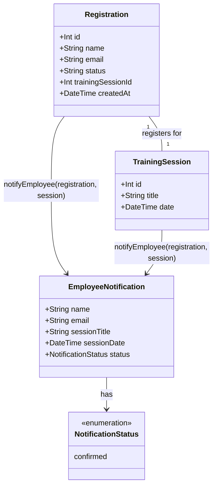

# Notify employee on confirmed registration (WH-8, registration slice only)

## Requirements
Notify an employee that their registration is confirmed, without ever blocking or failing the registration response.

## Entities

`EmployeeNotification` is not a persisted entity or a new Prisma model — it is the plain-object parameter shape passed into `notifyEmployee`, assembled from the existing `Registration` and `TrainingSession` records already available at the call site. No schema changes in this slice.

## Approach
1. Notification dispatch:
   - Add one new backend-only function, `notifyEmployee`, invoked exactly once: from `registerForSession`'s `confirmed` branch in `api/src/services/trainingSessionService.ts`.
   - `notifyEmployee` is fire-and-forget from the caller's perspective — the caller does not `await` it and its outcome never affects the HTTP response.
   - Within `notifyEmployee`, all work (console log, optional Slack call) is wrapped so any failure is caught and logged server-side, never re-thrown.

2. Technical implementation:
   - New file `api/src/services/notificationService.ts`, plain async function, no new dependency (no event-emitter library, no Slack SDK) — matches the project's existing plain-service-function pattern (see `trainingSessionService.ts`) rather than introducing a new architectural shape for one call site.
   - Slack delivery is a conditional branch inside the same function, gated on `process.env.SLACK_WEBHOOK_URL` being set, using the global `fetch` already available in the project's Node runtime — no new HTTP client dependency.
   - No changes to the global error handler in `app.ts` — this is a fire-and-forget side effect inside a service function, not a request-handling exception.

3. Business logic:
   - Trigger condition: only the `confirmed` branch of `registerForSession`. The `waitlisted` branch, `cancelRegistration`, and `promoteFromWaitlist`'s existing `notifyPromotion` seam are explicitly untouched by this slice.
   - Validation/error handling strategy: `notifyEmployee` validates nothing from the caller (the caller already validated `name`/`email` at the route layer) — its only error handling concern is swallowing failures from the console/Slack delivery steps themselves.
   - Workflow: `registerForSession` (confirmed branch) persists the registration inside its existing `$transaction`, then — after the transaction resolves successfully — calls `notifyEmployee` without awaiting it, then returns the `RegistrationResult` to the route as it does today.

## Structure

### Inheritance Relationships
None introduced. `notifyEmployee` is a plain exported async function, not a class; no new interfaces, base classes, or exception types are added in this slice.

### Dependencies
1. `registerForSession` (in `trainingSessionService.ts`) calls `notifyEmployee` (in `notificationService.ts`).
2. `notifyEmployee` depends on `process.env.SLACK_WEBHOOK_URL` (read, not written) and the global `fetch`.
3. `notifyEmployee` takes a `Registration` row and a `TrainingSession` row (or the subset of fields it needs from each) as plain arguments — it does not query Prisma itself, keeping all `prisma.*` calls inside `trainingSessionService.ts` per the project's existing layering rule.

### Layered Architecture
1. Route Layer (`api/src/routes/training-sessions.ts`): unchanged — still only parses/validates input, calls `registerForSession`, shapes the response.
2. Service Layer (`api/src/services/trainingSessionService.ts`): gains one new fire-and-forget call to `notifyEmployee` inside the `confirmed` branch of `registerForSession`. No other behavior in this file changes.
3. New Service Module (`api/src/services/notificationService.ts`): owns `notifyEmployee` — console log always, Slack webhook conditionally, all failures caught internally.
4. Data Access: no changes — `notifyEmployee` receives already-fetched data as arguments, it does not call `prisma` itself.

## Operations

### Create Service Module - `api/src/services/notificationService.ts`
1. Responsibility: send a best-effort notification that an employee's registration is confirmed, via console log and (optionally) Slack, without ever throwing back to its caller.
2. Attributes: none (stateless module of functions).
3. Methods:
   - `notifyEmployee(params: { name: string; email: string; sessionTitle: string; sessionDate: Date; status: 'confirmed' }): Promise<void>`
     - Logic:
       - Build a single log line containing `name`, `email`, `sessionTitle`, `sessionDate` (ISO string), and `status`; `console.log` it unconditionally.
       - If `process.env.SLACK_WEBHOOK_URL` is set and non-empty: `fetch` a `POST` to that URL with a minimal JSON payload (e.g. `{ text: "<name> (<email>) confirmed for <sessionTitle> on <sessionDate>" }`), inside its own `try/catch`.
       - Wrap the entire function body in a `try/catch` — any thrown error (console formatting issue, fetch network error, non-OK Slack response) is caught and passed to `console.error`, never re-thrown, so a caller that does not even `await` this function can never observe a rejected promise as an unhandled rejection.
4. Annotations: none (plain TypeScript, no decorators in this codebase).
5. Constraints: must not import or call `prisma` directly (keeps `prisma.*` calls confined to `trainingSessionService.ts` per `CLAUDE.md`'s layering rule); must not `await` anything that can block its caller — the function itself may be `async` and do internal awaits, but the caller of `notifyEmployee` must never `await` it.

### Update Service - `registerForSession` in `api/src/services/trainingSessionService.ts`
1. Interface Definition: no signature change — still `registerForSession(sessionId: number, name: string, email: string): Promise<RegistrationResult>`.
2. Core Method change: in the `confirmedUpdate.count === 1` branch, after the `registration` row is created and before `return { status: 'confirmed', registration }`, call `notifyEmployee({ name: registration.name, email: registration.email, sessionTitle: session.title, sessionDate: session.date, status: 'confirmed' })` without `await`.
   - Input Validation: none added — `name`/`email` are already validated at the route layer; `session` and `registration` are already guaranteed non-null at this point in the existing code.
   - Business Logic: exactly one new fire-and-forget call, no other logic change to this branch.
   - Exception Handling: none needed at this call site — `notifyEmployee` guarantees it does not throw or reject in a way that surfaces to the caller.
   - Return Value: unchanged — still returns `{ status: 'confirmed', registration }`.
3. Dependency Injection: import `notifyEmployee` from `../services/notificationService` (new import at the top of `trainingSessionService.ts`).
4. Transaction Management: the `notifyEmployee` call happens using data already read/written inside the existing `$transaction`, but the call itself is made after the transaction's callback has computed its result — it must not be awaited inside the transaction, so it can never hold a DB connection open or cause a rollback.

## Norms
1. Annotation Standards: none apply — this codebase does not use decorators/annotations (plain Express + Prisma + TypeScript functions).
2. Dependency Injection: follow the existing pattern in `trainingSessionService.ts` — plain function imports, no DI container or framework.
3. Exception Handling: no new exception types. `notifyEmployee` must internally catch and log every failure path (console formatting, fetch rejection, non-2xx Slack response) via `console.error`, and must never let a rejected promise propagate to its caller.
4. Data Validation: none performed inside `notifyEmployee` — it trusts its caller's already-validated inputs, consistent with the project's existing pattern of validating once at the route layer.
5. Logging: use `console.log` for the baseline notification (per the story's "logged to the server console" requirement) and `console.error` for any internal failure — do not introduce a new logging library for this slice.
6. Documentation Standards: no new comment conventions — follow the existing codebase's sparse-comment style; only comment the one line in `trainingSessionService.ts` where `notifyEmployee` is called, if the call site's intent (fire-and-forget) is not obvious from the lack of `await`.
7. No `any`: `notifyEmployee`'s parameter object must be fully typed (per `CLAUDE.md`'s "No `any`" team norm).

## Safeguards
1. Functional Constraint: `notifyEmployee` is called from exactly one place — the `confirmed` branch of `registerForSession` in WH-8's registration slice. It must NOT be wired into `promoteFromWaitlist`'s existing `notifyPromotion` seam, the `waitlisted` branch of `registerForSession`, or `cancelRegistration` — those are out of scope for this slice and belong to a later one.
2. Functional Constraint: no UI changes. `TrainingSessionCard.tsx` and any other `app/src` file must not be touched by this slice — the banner/dismiss acceptance criteria belong to a separate, later slice.
3. Resiliency Constraint: a thrown or rejected error from `notifyEmployee` (console formatting failure, Slack `fetch` network error, non-2xx Slack response) must never cause `registerForSession` to throw, never change the HTTP status code or body returned by `POST /api/training-sessions/:id/registrations`, and must never be awaited by the caller.
4. Integration Constraint: the Slack webhook call is optional and gated strictly on `process.env.SLACK_WEBHOOK_URL` being a non-empty string; when unset, no network call of any kind is attempted.
5. Technical Constraint: no new npm dependency is added for this slice (no event-emitter library, no Slack SDK, no HTTP client beyond the runtime's built-in `fetch`).
6. Data Constraint: `notifyEmployee` must not query Prisma directly — `prisma.*` calls stay confined to `trainingSessionService.ts`, per the project's existing routes→services→Prisma layering rule in `CLAUDE.md`.
7. Test Constraint: unit tests for this slice live at `api/tests/unit/notificationService.test.ts` and must assert both the console-log path and the fire-and-forget guarantee (a thrown/rejected internal error does not reject the promise returned by `notifyEmployee` itself, from the caller's point of view, in a way that requires the caller to handle it).
8. Story reference: this canvas implements the registration-notification slice of WH-8 (`Send notification after registration or waitlist promotion`, https://github.com/Estois/workshophub/issues/14) — the waitlist-promotion half of WH-8 is a separate, later slice.
