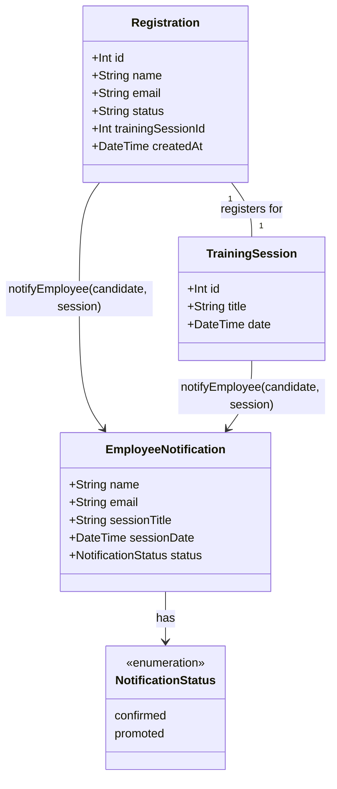

# Notify employee on waitlist promotion (WH-8, promotion slice)

## Requirements
Notify an employee that they have been promoted from the waitlist to a confirmed seat, reusing the existing registration-confirmation notification path, without ever blocking or failing the cancellation/promotion response.

## Entities

`NotificationStatus` widens from the previous slice's `'confirmed'`-only literal to `'confirmed' | 'promoted'` — the only type change in this slice. No new Prisma models, no schema changes.

## Approach
1. Notification dispatch:
   - Reuse `notifyEmployee` from `api/src/services/notificationService.ts` as-is (console log + optional Slack, fire-and-forget, never throws) — no changes to its internal logic.
   - Add exactly one new call site: inside `promoteFromWaitlist` in `api/src/services/trainingSessionService.ts`, replacing the existing no-op `notifyPromotion` seam.
   - The call remains fire-and-forget (no `await`), matching the pattern already established in `registerForSession`.

2. Technical implementation:
   - Widen `NotifyEmployeeParams['status']` in `notificationService.ts` from the literal `'confirmed'` to the union `'confirmed' | 'promoted'`. This is the only edit to that file in this slice.
   - Fetch the `TrainingSession` row inside `promoteFromWaitlist` via `tx.trainingSession.findUnique({ where: { id: sessionId } })`, using the transaction client already passed into the function — no new Prisma client instance, no raw SQL.
   - Delete the now-redundant `notifyPromotion` wrapper function and call `notifyEmployee` directly from `promoteFromWaitlist`, since the wrapper's only role was holding this slice's seam and it doesn't carry enough data (only a registration ID) to call `notifyEmployee` itself.

3. Business logic:
   - Trigger condition: only fires when `promoteFromWaitlist` actually promotes a candidate — i.e. after both existing early-return guards (`!candidate`, `update.count === 0`) have passed, and after the `trainingSession.update` that increments `registered`.
   - No notification fires when there is no waitlisted candidate to promote (existing `return null` path is untouched).
   - `cancelRegistration` (the caller of `promoteFromWaitlist`) is not itself modified — it continues to call `promoteFromWaitlist` the same way and receives the same `number | null` return value.

## Structure

### Inheritance Relationships
None introduced or changed. `notifyEmployee` remains a plain exported async function; `NotifyEmployeeParams` remains a plain exported type (its `status` field widened).

### Dependencies
1. `promoteFromWaitlist` (in `trainingSessionService.ts`) calls `notifyEmployee` (in `notificationService.ts`) — new dependency edge, same direction and shape as the existing `registerForSession` → `notifyEmployee` edge.
2. `promoteFromWaitlist` gains a new read: `tx.trainingSession.findUnique(...)`, using the `Prisma.TransactionClient` already passed in as its first parameter.
3. The now-deleted `notifyPromotion` function and its single internal call site are removed together.

### Layered Architecture
1. Route Layer: unchanged — no route calls `promoteFromWaitlist` directly; it's only reached via `cancelRegistration`, whose route (`DELETE /:id/registrations/:registrationId`) is unmodified.
2. Service Layer (`trainingSessionService.ts`): `promoteFromWaitlist` gains one new read (`trainingSession.findUnique`) and one new fire-and-forget call (`notifyEmployee`), replacing the deleted `notifyPromotion` no-op.
3. Notification Service Module (`notificationService.ts`): only its exported `NotifyEmployeeParams['status']` type is widened; `notifyEmployee`'s implementation body is unchanged.
4. Data Access: the new `tx.trainingSession.findUnique` call stays inside the existing transaction boundary (`tx`), consistent with the project's routes→services→Prisma layering rule — no new direct Prisma usage outside the service layer.

## Operations

### Update Type - `NotifyEmployeeParams` in `api/src/services/notificationService.ts`
1. Change: widen `status: 'confirmed'` to `status: 'confirmed' | 'promoted'`.
2. Constraints: no other change to this file — `notifyEmployee`'s function body, console log line, and Slack webhook logic are untouched (they already interpolate `status` generically via template string, so they handle the new value with no further code change).

### Update Service - `promoteFromWaitlist` in `api/src/services/trainingSessionService.ts`
1. Interface Definition: no signature change — still `promoteFromWaitlist(tx: Prisma.TransactionClient, sessionId: number): Promise<number | null>`.
2. Core Method change:
   - After the existing `await tx.trainingSession.update({ where: { id: sessionId }, data: { registered: { increment: 1 } } })` call, fetch the session: `const session = await tx.trainingSession.findUnique({ where: { id: sessionId } })`. (Alternative placement: fetch earlier, right after `candidate` is found — either is acceptable; fetching right before the notification call keeps the diff minimal and colocated.)
   - Replace the existing `notifyPromotion(candidate.id)` line with a direct call: `if (session) { notifyEmployee({ name: candidate.name, email: candidate.email, sessionTitle: session.title, sessionDate: session.date, status: 'promoted' }) }` — called WITHOUT `await`. The `if (session)` guard exists only because `findUnique` is typed as nullable; in practice the session cannot have disappeared mid-transaction, but the guard keeps strict typing without a non-null assertion.
   - Delete the `notifyPromotion` function definition entirely (it is no longer called from anywhere).
   - Return value: unchanged — still `return candidate.id`.
3. Dependency Injection: import `notifyEmployee` from `../services/notificationService` — this import already exists in this file from the previous slice; no new import statement needed, just the new call site.
4. Transaction Management: the new `trainingSession.findUnique` read happens inside the existing `tx` (the function's own transaction parameter) — it does not open a new transaction. The `notifyEmployee` call itself is not awaited, consistent with the existing registration-slice pattern of never blocking on notification delivery inside a transaction.

## Norms
1. Annotation Standards: none apply (no decorators in this codebase).
2. Dependency Injection: follow the existing pattern — plain function imports, no DI container.
3. Exception Handling: no new exception types. `notifyEmployee`'s existing internal try/catch already covers this new call site; no additional error handling needed at the call site in `promoteFromWaitlist`.
4. Data Validation: none added — `candidate.name`/`candidate.email` are already-persisted, validated-at-creation-time fields; `session` is guarded for null via the existing nullable return of `findUnique`.
5. Logging: unchanged — `notifyEmployee` already owns all console.log/console.error behavior.
6. Documentation Standards: remove the now-stale `// WH-8 trigger point: notification delivery is not implemented yet, this is a no-op seam.` comment along with the deleted `notifyPromotion` function, since the seam is now filled.
7. No `any`: the widened `status` type must remain a literal union (`'confirmed' | 'promoted'`), not `string`.

## Safeguards
1. Functional Constraint: `notifyEmployee` is called from `promoteFromWaitlist` only when a candidate is actually promoted — never on the early-return `null` paths (no candidate found, or the race-guarded `update.count === 0` path).
2. Functional Constraint: no UI changes. `app/src` is not touched by this slice.
3. Functional Constraint: `registerForSession`'s existing notification call site (from the previous slice) is not modified by this slice.
4. Resiliency Constraint: a thrown or rejected error from this new `notifyEmployee` call must never cause `promoteFromWaitlist` or its caller `cancelRegistration` to throw, and must never change the HTTP response of `DELETE /api/training-sessions/:id/registrations/:registrationId`.
5. Technical Constraint: no new npm dependency; reuse `notifyEmployee` and global `fetch` exactly as already implemented.
6. Data Constraint: the new `tx.trainingSession.findUnique` call must use the `tx` parameter already passed into `promoteFromWaitlist` — it must not use the top-level `prisma` singleton, to stay inside the existing transaction boundary.
7. Test Constraint: tests for this slice extend `api/tests/unit/notificationService.test.ts` (for the widened `status` type, if applicable) and/or add assertions to the existing integration test(s) that exercise `cancelRegistration`'s promotion path — do not create a new test file unless the existing ones cannot accommodate the new assertions without becoming unreadable.
8. Story reference: this canvas implements the waitlist-promotion half of WH-8 (`Send notification after registration or waitlist promotion`, https://github.com/Estois/workshophub/issues/14) — the registration half is already merged (PR #26); the UI banner half remains a separate, later slice.
