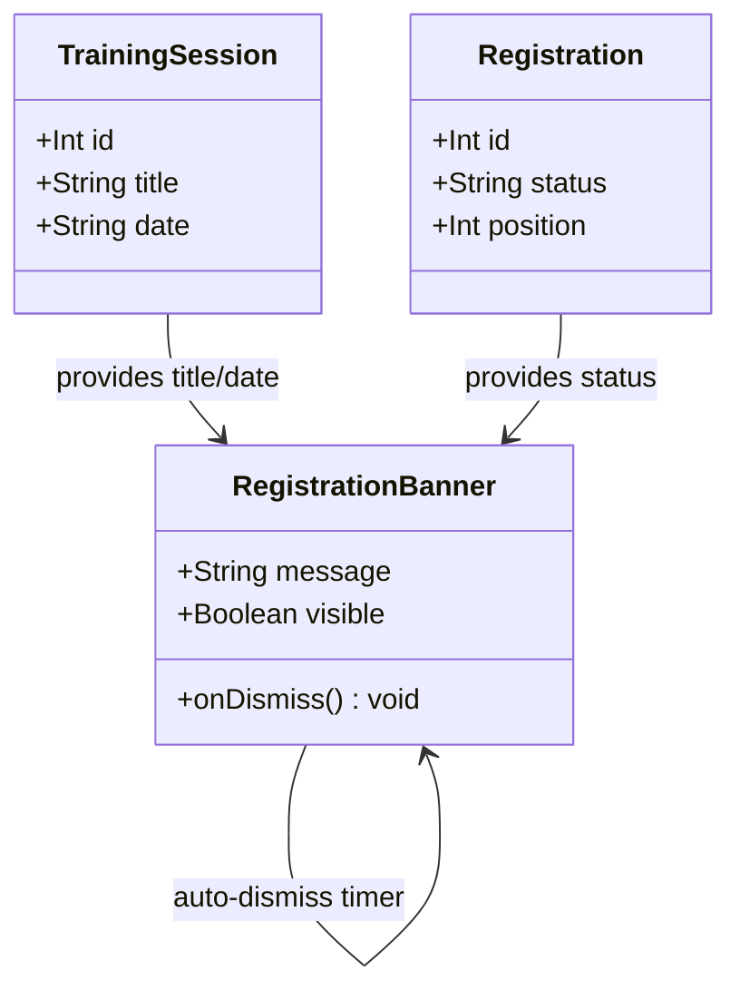

# Success/waitlist banners after registration (WH-8, UI slice)

## Requirements
Show the employee a dismissible, auto-expiring confirmation banner immediately after registering or joining a waitlist, independent of whether the backend notification succeeds.

## Entities

`RegistrationBanner` is a new presentational component, not a data entity — no new types are added to `app/src/types`. `TrainingSession` and `Registration` are existing types, unchanged.

## Approach
1. Banner rendering:
   - Replace the existing inline `
` block in `TrainingSessionCard.tsx` with a small new presentational component, `RegistrationBanner`, that takes the already-available `result` (status + position) and `session` (title + date) and renders the two specified copy strings.
   - The banner replaces, not wraps, the existing message — the `cancelled` message path (`"Your registration has been cancelled"`) stays exactly as it is today, since cancellation notifications are explicitly out of scope.

2. Technical implementation:
   - New file `app/src/components/RegistrationBanner.tsx` (+ a small `.css` file following this codebase's existing per-component CSS file convention), a stateless component taking `message: string`, `onDismiss: () => void` as props — dismiss timing/state lives in the parent (`TrainingSessionCard`), not inside the banner itself, keeping the banner a pure presentational component.
   - Extract the existing `formatDate` function out of `SessionDetailPage.tsx` into a new shared utility, `app/src/utils/formatDate.ts`, and import it from both `SessionDetailPage.tsx` (replacing its local copy, same behavior) and the new banner-building logic in `TrainingSessionCard.tsx`.
   - Auto-dismiss via a `useEffect` in `TrainingSessionCard.tsx`, keyed on `result`, using `setTimeout(..., 5000)`, cleared in the effect's cleanup function.

3. Business logic:
   - Banner visibility state (`bannerDismissed`, a new local `useState<boolean>` in `TrainingSessionCard.tsx`) resets to `false` whenever a new `result` is set (new registration attempt), and is set to `true` either by the user clicking dismiss or by the auto-dismiss timer firing.
   - Banner copy: for `result.status === 'confirmed'`, `` `You're registered! ${session.title} on ${formatDate(session.date)}` ``; for `result.status === 'waitlisted'`, the fixed string `` `You're on the waitlist for ${session.title}. We'll let you know if a spot opens up.` `` (no position number, per the story's exact specified copy).
   - No dependency whatsoever on the backend notification's outcome — the banner is driven purely by the existing registration API response already stored in `result`.

## Structure

### Inheritance Relationships
None introduced. `RegistrationBanner` is a plain functional React component (same pattern as every other component in `app/src/components`), not a class.

### Dependencies
1. `TrainingSessionCard.tsx` imports and renders `RegistrationBanner` (new dependency) instead of the existing inline `
` block for the `result` case.
2. `TrainingSessionCard.tsx` imports `formatDate` from the new `app/src/utils/formatDate.ts` (new dependency).
3. `SessionDetailPage.tsx` imports the same `formatDate` from `app/src/utils/formatDate.ts`, replacing its own local definition (dependency direction changes: was self-contained, now depends on the shared utility).
4. `RegistrationBanner` has no dependencies beyond its own props — it does not import `TrainingSession`/`Registration` types directly, it receives already-computed strings/booleans.

### Layered Architecture
1. Page/Component Layer (`app/src/components/TrainingSessionCard.tsx`): owns the `bannerDismissed` state, the auto-dismiss timer, and the copy-building logic; renders `RegistrationBanner` with the computed message.
2. New Presentational Component (`app/src/components/RegistrationBanner.tsx`): pure rendering + a dismiss button, no state of its own beyond what's passed in as props.
3. Shared Utility (`app/src/utils/formatDate.ts`): pure function, no component dependencies, usable from any page or component.
4. No backend layer changes — this slice is entirely within `app/src`.

## Operations

### Create Utility - `app/src/utils/formatDate.ts`
1. Responsibility: format an ISO date string into the existing human-readable format already used by `SessionDetailPage.tsx`.
2. Methods:
   - `formatDate(dateStr: string): string`
     - Logic: identical body to the existing `formatDate` function currently defined locally in `SessionDetailPage.tsx` — `new Date(dateStr).toLocaleDateString('en-SG', { weekday: 'long', year: 'numeric', month: 'long', day: 'numeric' })`. No behavior change, pure extraction.
3. Constraints: no new dependency; must produce byte-identical output to the current `SessionDetailPage.tsx` behavior for the same input (this is a refactor, not a behavior change).

### Update - `app/src/pages/SessionDetailPage.tsx`
1. Remove the locally-defined `formatDate` function.
2. Import `formatDate` from `../utils/formatDate` instead.
3. No other change to this file — its existing usage of `formatDate(session.date)` stays exactly as written, now resolving to the imported function.

### Create Component - `app/src/components/RegistrationBanner.tsx`
1. Responsibility: render a dismissible confirmation message.
2. Props:
   - `message: string` - the banner's exact text content
   - `onDismiss: () => void` - called when the user clicks the dismiss control
3. Methods: none beyond the function component body itself.
4. Render logic: a container element with class `registration-banner`, the `message` text, and a dismiss button (plain `<button>`, following this codebase's existing unstyled-button convention) that calls `onDismiss` on click.
5. Constraints: purely presentational — no internal state, no `useEffect`, no timers. All dismiss/auto-dismiss timing logic lives in the parent component.

### Update Component - `app/src/components/TrainingSessionCard.tsx`
1. Add new state: `const [bannerDismissed, setBannerDismissed] = useState(false)`.
2. Add a `useEffect` keyed on `result`:
   - On a new non-null `result`, reset `bannerDismissed` to `false` and start a `setTimeout(() => setBannerDismissed(true), 5000)`.
   - Cleanup function clears the timeout.
3. Compute the banner message when `result` is non-null and not `cancelled`:
   - `result.status === 'confirmed'` → `` `You're registered! ${session.title} on ${formatDate(session.date)}` ``
   - `result.status === 'waitlisted'` → `` `You're on the waitlist for ${session.title}. We'll let you know if a spot opens up.` ``
4. Replace the existing conditional render:
   - When `result` exists, `!cancelled`, and `!bannerDismissed`: render `<RegistrationBanner message={bannerMessage} onDismiss={() => setBannerDismissed(true)} />` in place of the current `
`.
   - When `cancelled`: keep the existing `"Your registration has been cancelled"` message exactly as it is today — untouched by this slice.
   - The existing `session-card__cancel-button` and `cancelError` rendering stay exactly as they are, positioned the same way relative to the (now banner-based) message.
5. Import `formatDate` from `../utils/formatDate` and `RegistrationBanner` from `./RegistrationBanner`.

## Norms
1. Component Style: functional components with hooks, matching every existing component in `app/src/components` and `app/src/pages` — no class components, no new state-management library.
2. Styling: a small `.css` file per component, matching the existing one-CSS-file-per-component convention (e.g. `RegistrationBanner.css` alongside `RegistrationBanner.tsx`), imported directly in the component file.
3. No `any`: `RegistrationBanner`'s props must be a fully-typed interface; `formatDate`'s parameter and return type must be explicit (`string` in, `string` out).
4. Testing: component tests (if added) should use the project's existing frontend test conventions if any exist; if none exist yet for components, a plain render + interaction test is acceptable scope for this slice — do not introduce a new test framework.
5. Timers in tests: any test exercising the auto-dismiss behavior must use fake timers (e.g. Jest's `jest.useFakeTimers()`) rather than real `setTimeout` delays, to keep the test suite fast and deterministic.
6. Documentation Standards: no new comment conventions; only comment the auto-dismiss `useEffect` if its 5-second timing choice isn't otherwise obvious from a named constant.

## Safeguards
1. Functional Constraint: no backend file is touched by this slice — `api/src/**` must have zero diff from this slice's changes.
2. Functional Constraint: the waitlist banner copy must match the story's exact specified string, without the position number that the current inline message includes — this is an intentional content change, not an oversight, per the Risk & Gap Analysis in the accompanying `/spdd-analysis` document.
3. Functional Constraint: the `cancelled` message path and the `session-card__cancel-button`/`cancelError` rendering are not modified by this slice beyond whatever repositioning is strictly necessary to accommodate the new banner render in the same conditional block.
4. Resiliency Constraint: the banner's visibility and content must never depend on the backend notification's success or failure — it is driven exclusively by the existing `result` state already returned from the registration API call.
5. Technical Constraint: no new npm dependency (no toast/notification library) — the banner is a plain React component with CSS, consistent with the rest of this codebase.
6. Technical Constraint: the `formatDate` extraction must not change `SessionDetailPage.tsx`'s rendered output for any existing date input — verify this is a pure refactor, not a behavior change.
7. Data Constraint: `RegistrationBanner` receives only primitive props (`string`, function) — it does not receive or depend on `TrainingSession`/`Registration` objects directly, keeping it reusable and independently testable.
8. Test Constraint: any new test for the auto-dismiss timer uses fake timers, not real delays.
9. Story reference: this canvas completes the UI half of WH-8 (`Send notification after registration or waitlist promotion`, https://github.com/Estois/workshophub/issues/14) — the backend half (registration and promotion notification triggers) is already implemented in earlier commits on this branch.
