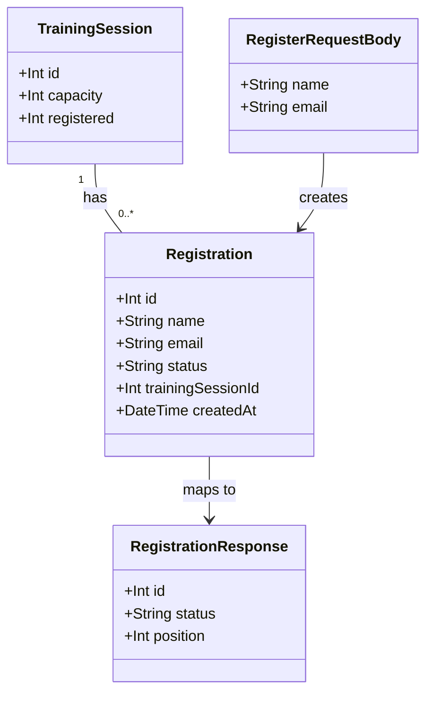

# Employee Training Session Registration with Waitlist Support

## Requirements
Implement employee self-service registration for a training session, automatically placing the employee on a session-scoped waitlist instead of rejecting them once the session reaches capacity.

## Entities

Conservative note: `TrainingSession` is unchanged — `registered` remains the existing persisted counter, read and written exactly as today. `RegistrationResponse.position` is only populated when `status = "waitlisted"`; omitted (or `null`) for `"confirmed"`.

## Approach
1. Endpoint Design:
   - Single endpoint `POST /api/training-sessions/:id/registrations` handles both the confirmed and waitlisted outcomes, branching internally on current capacity — not two separate routes. This matches the stories' shared acceptance criteria and avoids building a 409 path that is immediately superseded.
   - Response status communicates outcome: `201` for confirmed, `202` for waitlisted, `400`/`404` for input errors, consistent with the existing route file's status-code-per-outcome style already used in `GET /:id`.

2. Technical Implementation:
   - Extend the existing Express + Prisma + SQLite stack; no new dependencies or infrastructure.
   - Route layer (`api/src/routes/training-sessions.ts`) parses/validates input and shapes the response only, per the project's `CLAUDE.md` norm — calls one new service function, never touches `prisma` directly (the file's existing `/search` route's direct Prisma use is a known, separately-tracked seed and must not be imitated).
   - Error handling stays in line with the existing pattern in this file: `try/catch` per route, flat `{ error: string }` JSON body, explicit status codes — no class-based exception hierarchy or global exception-handler middleware is introduced, because none exists in this codebase (`api/src/app.ts`'s catch-all error middleware returns `{ error, stack, timestamp }` and is unrelated to normal 4xx business outcomes).
   - Concurrency: the capacity check, status decision, counter increment, and `Registration` row creation are all performed inside one `prisma.$transaction`, using an atomic conditional update (`updateMany` with a `where` clause requiring `registered < capacity`) to decide — within the transaction — whether this request wins a confirmed spot, rather than a separate read-then-write.

3. Business Logic:
   - Core rule: a registration is `confirmed` iff the conditional capacity-guarded update affects a row (i.e., `registered < capacity` held at the moment of the atomic update); otherwise it is `waitlisted`. Never rejected outright for being full.
   - Validation order: session existence (404) → required-field validation (400) → capacity branch (201 confirmed / 202 waitlisted). Field validation must run even when the session is already full.
   - Waitlist position is computed, not stored: `count of Registration rows for this session where status = 'waitlisted'` at the time of this insert, plus 1 (this insert is the last one counted, immediately after creation).

## Structure

### Inheritance Relationships
1. No new interfaces, abstract classes, or exception class hierarchies are introduced — the codebase has none for this layer and none are needed; errors are communicated via HTTP status + plain JSON body, matching existing routes.

### Dependencies
1. `training-sessions.ts` route calls `registerForSession` (new function in `trainingSessionService.ts`) — the route has zero direct `prisma.*` calls.
2. `trainingSessionService.ts` depends on `prisma` (the singleton from `api/src/lib/prisma.ts`), same as existing `getAllSessions`/`getSessionById`.
3. `TrainingSessionCard.tsx` (frontend) depends on a new fetch call to `POST /api/training-sessions/:id/registrations`, following the existing inline-`fetch`-per-component pattern already used in this codebase (no shared API client exists; do not introduce one).

### Layered Architecture
1. Route Layer (`api/src/routes/training-sessions.ts`): parses `id` param and JSON body, calls the service, maps the service's result shape to the correct HTTP status and response body. No validation logic beyond type/presence checks, no Prisma calls.
2. Service Layer (`api/src/services/trainingSessionService.ts`): owns all business logic — session lookup, the transactional capacity decision, `Registration` creation, position computation. Returns a plain discriminated result object to the route (not an HTTP-shaped object).
3. Data Access: Prisma Client via the existing singleton, inside a single `$transaction` block for the write path.
4. Error Handling: inline `try/catch` in the route handler, consistent with existing routes in this file — no separate exception-handling layer.

## Operations

### Update Prisma Schema — Registration model
1. Responsibility: persist one registration attempt per employee per session, with a status distinguishing confirmed/waitlisted/cancelled.
2. Attributes:
   - `id`: Int - primary key, autoincrement
   - `name`: String - employee name, required
   - `email`: String - employee email, required
   - `status`: String - one of `confirmed` | `waitlisted` | `cancelled`, no default (always set explicitly at creation to `confirmed` or `waitlisted`)
   - `trainingSessionId`: Int - foreign key to `TrainingSession.id`
   - `createdAt`: DateTime - `@default(now())`, used to order waitlist position
3. Relation: add `registrations Registration[]` back-reference on `TrainingSession`; `Registration.trainingSession TrainingSession @relation(fields: [trainingSessionId], references: [id])`.
4. Annotations: `@@map("registrations")` to match the existing snake_case table naming convention (`training_sessions`).
5. Constraints: `trainingSessionId` + `createdAt` should be indexed (`@@index([trainingSessionId, status, createdAt])`) to make the waitlist-position count and per-session lookups efficient.
6. After schema edit: run `prisma db push` to apply, then update `api/prisma/seed.ts` to delete `registration` rows before `trainingSession` rows (deleting sessions first will now violate the new FK constraint).

### Implement Service Function — registerForSession
1. Interface Definition: `registerForSession(sessionId: number, name: string, email: string): Promise<RegistrationResult>` where `RegistrationResult` is a discriminated union: `{ status: 'not_found' } | { status: 'confirmed', registration: Registration } | { status: 'waitlisted', registration: Registration, position: number }`.
2. Core Methods:
   - Input Validation: none at this layer — `name`/`email` presence is already guaranteed by the route before this function is called; this function assumes valid strings.
   - Business Logic:
     - Open `prisma.$transaction`.
     - Inside the transaction: attempt `prisma.trainingSession.updateMany({ where: { id: sessionId, registered: { lt: capacity-comparison-via-raw-field } }, data: { registered: { increment: 1 } } })` — since Prisma's `updateMany` `where` cannot compare two columns of the same row directly, use `prisma.trainingSession.findUnique({ where: { id: sessionId } })` first inside the transaction to confirm existence and read `capacity`, then follow with a conditional `updateMany({ where: { id: sessionId, registered: { lt: session.capacity } }, data: { registered: { increment: 1 } } })`. If the session read returns null, return `{ status: 'not_found' }` immediately (no transaction side effects).
     - If the conditional `updateMany` reports `count === 1`: this request wins a confirmed spot. Create a `Registration` row with `status: 'confirmed'`. Return `{ status: 'confirmed', registration }`.
     - If `count === 0`: capacity was already reached (either from the start, or another concurrent transaction won first). Create a `Registration` row with `status: 'waitlisted'` (no counter increment). Then, still inside the same transaction, count existing `Registration` rows for this session with `status: 'waitlisted'` created at or before this new row's `createdAt` (or simply: count all waitlisted rows for the session including the new one, ordered by `createdAt` ascending, and take this row's 1-based index) to compute `position`. Return `{ status: 'waitlisted', registration, position }`.
     - Exception Handling: let Prisma errors propagate — the route's `try/catch` handles them with the existing 500 pattern used elsewhere in the file.
   - Return Value: the discriminated `RegistrationResult` described above; the route maps each variant to its HTTP status.
3. Dependency Injection: none — uses the existing `prisma` singleton import, consistent with every other function in this service file.
4. Transaction Management: the entire read-decide-write sequence (session lookup, conditional capacity update, `Registration` insert, waitlist position count) occurs inside one `prisma.$transaction` to prevent two concurrent requests from both reading `registered < capacity` as true and both confirming for the same last spot.

### Update Route Handler — POST /:id/registrations
1. Responsibility: parse and validate `id` (route param) and `name`/`email` (JSON body), call `registerForSession`, map its result to the correct HTTP response. No Prisma import, no business logic beyond input shape checks.
2. Logic:
   - Parse `id` via `parseInt(req.params.id, 10)`; if `isNaN`, return 400 (consistent with the existing `GET /:id` handler's pattern, though not explicitly required by the stories — defensive, matches existing convention).
   - Read `name` and `email` from `req.body`. If either is missing, not a string, or (after `.trim()`) empty, return `400` with `{ error: 'name and email are required' }`. Perform the `typeof !== 'string'` check before any `.trim()` call to avoid a runtime error on non-string JSON values (e.g. a numeric or array field).
   - Call `registerForSession(id, name.trim(), email.trim())`.
   - If result `status === 'not_found'`: `404` with `{ error: 'Training session not found' }`.
   - If result `status === 'confirmed'`: `201` with `{ id: registration.id, status: 'confirmed' }`.
   - If result `status === 'waitlisted'`: `202` with `{ id: registration.id, status: 'waitlisted', position }`.
   - Wrap the whole handler body in `try/catch`; on unexpected error, `console.error` + `500` with `{ error: 'Failed to register for training session' }`, consistent with the file's existing catch blocks.
3. Annotations: none (plain Express `router.post`).
4. Constraints: route added to the same `router` instance already exported from this file, positioned after the existing `/:id` GET handler.

### Update Frontend Type — Registration
1. Responsibility: type the new domain concept for the frontend.
2. Attributes: add to `app/src/types/index.ts`:
   - `interface Registration { id: number; status: 'confirmed' | 'waitlisted'; position?: number }`
3. No changes to the existing `TrainingSession` interface — `registered`/`capacity` continue to work exactly as today.

### Update Frontend Component — TrainingSessionCard
1. Responsibility: let the employee submit name/email, show a register CTA when space is available and a "Join Waitlist" CTA when full, and display the resulting confirmation or waitlist message.
2. State: local component state for form visibility, `name`, `email`, and the submission result (`Registration | null` plus an error message string).
3. Logic:
   - Keep the existing `isFull` computation (`capacity - registered <= 0`) unchanged — it continues to gate which CTA label is shown ("Register" vs "Join Waitlist"), but no longer hides the action entirely when full.
   - On submit: `fetch(`/api/training-sessions/${session.id}/registrations`, { method: 'POST', body: JSON.stringify({ name, email }) })`, matching this codebase's existing inline-fetch-per-component convention (no shared API client).
   - On `201` response: show a confirmation message (e.g. "You're registered!").
   - On `202` response: show a distinct waitlist message including the returned `position` (e.g. "You're on the waitlist, position {position}").
   - On `400`/`404`/`500`: show the response's `error` message inline, do not clear the form.
4. Constraints: reuse existing CSS class naming convention (`session-card__*`, `meta-*`) in `TrainingSessionCard.css`; no new component library or styling framework introduced.

### Update Seed Script — api/prisma/seed.ts
1. Responsibility: keep `make seed`/`make reset-db` working after the `Registration` FK is added.
2. Logic: add `await prisma.registration.deleteMany()` immediately before the existing `await prisma.trainingSession.deleteMany()` call, so child rows are cleared before parent rows.
3. Constraint: no change to the existing `trainingSession.createMany` seed data.

## Norms
1. Annotation Standards: no decorators/annotations are used anywhere in this codebase (plain TypeScript + Express) — do not introduce any (no `@Injectable`, no `@Controller`, etc.).
2. Dependency Injection: none in use; continue importing the `prisma` singleton directly, matching every existing service function.
3. Exception Handling:
   - No custom exception classes or hierarchy — Prisma/runtime errors are caught with plain `try/catch` in the route handler and converted to a `{ error: string }` JSON body with the appropriate status code.
   - Business outcomes that are not exceptional (not_found, confirmed, waitlisted) are expressed as a typed return value from the service function, not thrown errors — only genuinely unexpected failures (DB connection issues, etc.) should reach the `catch` block.
   - No global exception-handler middleware is added; `api/src/app.ts`'s existing catch-all error middleware (which returns `err.stack`) is out of scope for this feature and must not be modified.
4. Data Validation: presence + type (`typeof x === 'string'`) + non-empty-after-trim checks performed in the route layer before calling the service, mirroring the existing `isNaN(id)` check style already in `GET /:id`.
5. Logging: `console.error` on unexpected failures only, matching the existing pattern in this route file (`console.error('Error fetching training sessions:', error)`).
6. Documentation Standards: no new comments beyond what's necessary to explain the transaction's non-obvious capacity-race mitigation; this codebase's existing files carry minimal inline comments (only the pre-existing `/search` security-seed comment is of that kind) — do not add explanatory comments for self-evident code.
7. Type Standards: no `any` anywhere (per `CLAUDE.md` team norm) — the `RegistrationResult` discriminated union, Express `Request`/`Response` generics, and Prisma-generated `Registration` type must all be explicitly typed.
8. Layering Standard: zero `prisma.*` or `$queryRaw*` calls permitted in `api/src/routes/training-sessions.ts` for this feature — all such calls live in `api/src/services/trainingSessionService.ts`, per `CLAUDE.md`.

## Safeguards
1. Functional Constraints: the endpoint must never return `409` for a full session — full sessions always produce `202 waitlisted`, per WH-3 superseding WH-2's original 409 AC.
2. Performance Constraints: the waitlist-position count query must be scoped to a single `trainingSessionId` and filtered by `status = 'waitlisted'` (using the new composite index) — must not scan the entire `registrations` table.
3. Security Constraints: `name`/`email` are stored as submitted with only trim + presence validation — no additional sanitization/escaping is required at this layer because all persistence goes through Prisma's parameterized query builder (no raw SQL is introduced for this feature, unlike the pre-existing `/search` seed).
4. Integration Constraints: the new route must be mounted on the existing `router` exported from `training-sessions.ts` (already wired into `app.ts` under `/api/training-sessions`) — no new top-level Express route group.
5. Business Rule Constraints:
   - `registered` must never exceed `capacity` — enforced solely by the transactional conditional `updateMany`, not by application-level pre-checks alone.
   - A `Registration` row's `status` must be exactly one of `confirmed` | `waitlisted` | `cancelled` — `cancelled` is not settable by this feature (reserved for WH-4, out of scope) but the schema must allow it without a future migration.
   - Waitlist position is always computed fresh at response time and must never be persisted as a stored, static field on `Registration`.
6. Exception Handling Constraints:
   - Unexpected errors must return a generic `{ error: string }` message — must not leak Prisma error internals or stack traces to the client (unlike the pre-existing, intentionally-vulnerable global error handler in `app.ts`, which is out of scope and must not be used as a model here).
   - All business-flow branches (404/400/201/202) must be handled explicitly in the route handler before the `catch` block is ever reached for those cases.
7. Technical Constraints: no new npm dependencies; must work within the existing Express 4 + Prisma 5.22 + SQLite stack; must account for SQLite's single-writer concurrency model when relying on the transaction for the capacity race (do not assume multi-writer RDBMS semantics).
8. Data Constraints: `name` and `email` must each be non-empty strings after trimming; no format/regex validation on `email` is required by either story and must not be added speculatively.
9. API Constraints:
   - `POST /api/training-sessions/:id/registrations` request body: `{ name: string, email: string }`.
   - Success responses: `201 { id, status: "confirmed" }` or `202 { id, status: "waitlisted", position }`.
   - Error responses: `400 { error }`, `404 { error }`, `500 { error }` — flat shape, matching every other endpoint in this route file.
10. Test Constraints: new tests must cover both the unit layer (`api/tests/unit/trainingSessionService.test.ts`, mocking `$transaction`) and the integration layer (`api/tests/integration/training-sessions.test.ts`, against the real SQLite test DB via `supertest`), per this repo's existing two-tier test convention — covering at minimum: 201 confirmed, 202 waitlisted with correct position, 400 missing fields (including when full), 404 unknown session, and registered-count increments only on the confirmed path.
