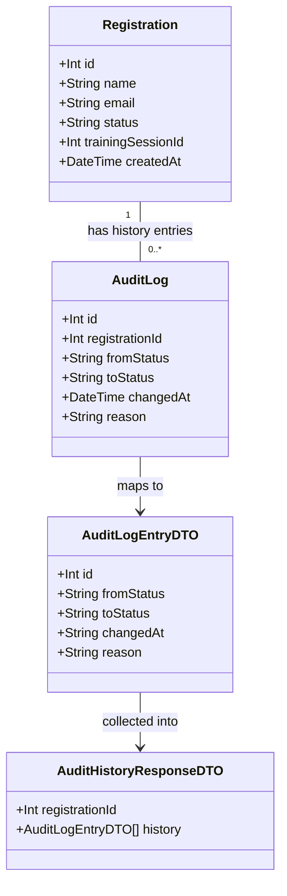

# WH-9: Audit Log for Registration State Changes

## Requirements
Implement an immutable audit trail that records every status transition a `Registration` undergoes (initial registration, waitlist promotion, cancellation), queryable per-registration via a read-only API endpoint, so training organisers can reconstruct the full lifecycle of any registration for compliance reporting and dispute resolution.

## Entities


## Approach
1. Data Model:
   - Add a new, purely additive `AuditLog` Prisma model with a foreign key to `Registration` (one-to-many: one registration has many ordered audit entries).
   - No changes to the existing `Registration` or `TrainingSession` models; `fromStatus` is nullable (null marks the birth of a registration), `toStatus` and `changedAt` are required, `reason` is nullable and left unpopulated (`null`) by every call site in this story — the field exists for future use but no current transition supplies text for it.
   - Ships via `prisma db push` per the project's no-migrations convention; purely additive (new table + FK), no risk to existing data.

2. Technical Implementation:
   - Instrument the four existing, already-transactional status-write call sites in `trainingSessionService.ts` (`registerForSession` ×2, `promoteFromWaitlist` ×1, `cancelRegistration` ×2 — five call sites in total, since `cancelRegistration` has two independent write branches) with a paired audit-entry write using the *same* `Prisma.TransactionClient` (`tx`) already in scope, so the audit row and the status change commit or roll back atomically — no new transaction boundaries are introduced.
   - Introduce one small shared helper, `recordTransition(tx, registrationId, fromStatus, toStatus)`, co-located in `trainingSessionService.ts` next to the transition logic it instruments, to keep the five call sites structurally identical and prevent field drift between them.
   - Add one new route, `GET /api/training-sessions/:id/registrations/:registrationId/audit`, as a sibling to the existing nested registration routes in `routes/training-sessions.ts`, delegating to a new read-only service function in a new file, `api/src/services/auditLogService.ts` (keeps the growing `trainingSessionService.ts` from taking on a second, independent read concern; team norms require all `prisma.*` calls to live under `api/src/services/*.ts` but don't mandate one file per concept, and `AuditLog`'s read path has no dependency on `TrainingSession` CRUD).
   - Existing global error handler in `app.ts` (returns `err.stack` in the response body) is untouched by this story — the new route follows the same try/catch-and-respond pattern already used by every other route in `training-sessions.ts`.

3. Business Logic:
   - Every one of the four real-world transitions (register→confirmed, register→waitlisted, waitlisted→confirmed via promotion, confirmed/waitlisted→cancelled) produces exactly one `AuditLog` row, written inside the transaction that performs the corresponding `Registration.status` write.
   - The promotion audit entry is written inside `promoteFromWaitlist` itself, using the `tx` parameter it already receives from its caller (`cancelRegistration`) — never a new `$transaction` — so the promotion's audit entry and the triggering cancellation commit together.
   - The audit-write call on each cancellation branch only fires on the branch where the guarded `updateMany` actually affected a row (`update.count === 1`), never unconditionally, so a no-op "already cancelled" request does not produce a spurious audit entry.
   - `GET .../audit` validates that the registration exists AND belongs to the given session (same pairing check already used by `DELETE /:id/registrations/:registrationId` and `cancelRegistration`); either condition failing returns a single 404, matching the existing codebase precedent for this exact `:id`/`:registrationId` pairing.
   - Audit entries are immutable by omission: no `PUT`/`PATCH`/`DELETE` route is ever added for `AuditLog`; this story adds no database-level write protection beyond "no mutating endpoint exists."

## Structure

### Inheritance Relationships
1. No new interfaces, abstract classes, or exception classes are introduced — this story follows the existing codebase convention of discriminated-union return types (`{ status: 'not_found' } | { status: 'ok'; ... }`) rather than a class hierarchy, matching `RegistrationResult`, `RegistrationsResult`, and `CancellationResult` already in `trainingSessionService.ts`.
2. `AuditLog` is a new Prisma-generated model type, structurally parallel to the existing `Registration` and `TrainingSession` generated types — no manual class is written for it.

### Dependencies
1. `routes/training-sessions.ts` calls `recordTransition`-instrumented functions in `trainingSessionService.ts` (already wired for register/cancel) and a new `getAuditHistory` function in the new `auditLogService.ts` (new wiring for the audit route).
2. `trainingSessionService.ts`'s `registerForSession`, `promoteFromWaitlist`, and `cancelRegistration` each call the new `recordTransition` helper, defined in the same file, passing the in-scope `tx`.
3. `auditLogService.ts` depends on the shared `prisma` singleton from `lib/prisma.ts` only (read-only queries, no transaction needed since reads don't mutate state).
4. No route handler calls `prisma.*` directly for this story's new code — the new route only parses `req.params`, calls the service, and shapes the JSON response, per team norms.

### Layered Architecture
1. Route Layer (`routes/training-sessions.ts`): parses/validates `:id` and `:registrationId` as integers, calls `getAuditHistory(sessionId, registrationId)`, maps the result's discriminant to the correct HTTP status and JSON body.
2. Service Layer — write side (`trainingSessionService.ts`): owns the `recordTransition` helper and all five audit-write call sites, co-located with the status-write logic they instrument.
3. Service Layer — read side (`auditLogService.ts`): owns `getAuditHistory`, which validates the registration/session pairing and queries ordered `AuditLog` rows.
4. Data Access Layer (`lib/prisma.ts`): the shared `PrismaClient` singleton; the new `AuditLog` model becomes available on it automatically once added to `schema.prisma` — no separate client or connection setup.
5. Error Handling Layer: unchanged existing per-route `try/catch` → `console.error` + JSON error body pattern; no new exception types or global handler changes.

## Operations

### Create/Update Prisma Model - AuditLog
1. Responsibility: Immutable record of one `Registration` status transition.
2. Attributes:
   - `id`: `Int` - primary key, `@id @default(autoincrement())`
   - `registrationId`: `Int` - foreign key to `Registration.id`
   - `fromStatus`: `String?` - nullable; `null` only for the first transition of a registration's life
   - `toStatus`: `String` - required; one of `'confirmed'`, `'waitlisted'`, `'cancelled'`
   - `changedAt`: `DateTime` - `@default(now())`
   - `reason`: `String?` - nullable; unpopulated (`null`) by every current call site
3. Relation: add `registration Registration @relation(fields: [registrationId], references: [id])` on `AuditLog`, and add the inverse `auditLogs AuditLog[]` on `Registration`.
4. Indexing: add `@@index([registrationId, changedAt])` to support the ordered-by-registration query the read endpoint performs.
5. Table mapping: `@@map("audit_logs")`, consistent with existing `@@map` usage (`training_sessions`, `registrations`).
6. Constraints: no `onDelete` cascade behavior is specified by the AC; omit `onDelete` (Prisma/SQLite default `NoAction`) since registrations are never hard-deleted in this codebase (cancellation is a status change, not a row deletion).

### Create Helper Function - recordTransition
1. Location: `api/src/services/trainingSessionService.ts`, defined once, called from all five existing transition call sites.
2. Signature: `recordTransition(tx: Prisma.TransactionClient, registrationId: number, fromStatus: string | null, toStatus: string): Promise<void>`
3. Logic:
   - Call `tx.auditLog.create({ data: { registrationId, fromStatus, toStatus, reason: null } })`.
   - No return value needed; callers do not branch on its result — if the `create` throws, it propagates and the enclosing `$transaction` rolls back, which is the desired "atomic with the status change" behavior.
4. Call sites to add (five total, no file restructuring otherwise):
   - `registerForSession`, confirmed branch (after line 52's `tx.registration.create` for `'confirmed'`): `recordTransition(tx, registration.id, null, 'confirmed')`.
   - `registerForSession`, waitlisted branch (after line 65's `tx.registration.create` for `'waitlisted'`): `recordTransition(tx, registration.id, null, 'waitlisted')`.
   - `promoteFromWaitlist` (immediately after the `update.count === 1` check passes, i.e. after line 119's `updateMany` to `'confirmed'` succeeds): `recordTransition(tx, candidate.id, 'waitlisted', 'confirmed')`.
   - `cancelRegistration`, confirmed→cancelled branch (immediately after the `update.count === 1` check passes, i.e. after line 161's `updateMany`): `recordTransition(tx, registrationId, 'confirmed', 'cancelled')`.
   - `cancelRegistration`, waitlisted→cancelled branch (immediately after the `update.count === 1` check passes, i.e. after line 176's `updateMany`): `recordTransition(tx, registrationId, 'waitlisted', 'cancelled')`.

### Create Service - auditLogService.ts
1. Responsibility: read-only access to a registration's ordered audit history, including the existence/pairing check that drives the route's 404.
2. Core Method: `getAuditHistory(sessionId: number, registrationId: number): Promise<AuditHistoryResult>`
   - Input Validation: both `sessionId` and `registrationId` are assumed already validated as integers by the route layer (matching the existing pattern for `cancelRegistration`'s callers).
   - Business Logic:
     - Look up the registration by `registrationId` via `prisma.registration.findUnique({ where: { id: registrationId } })`.
     - If not found, or found but `registration.trainingSessionId !== sessionId`, return `{ status: 'not_found' }` — single 404 condition, mirroring the exact precedent in `cancelRegistration` (`trainingSessionService.ts:149`).
     - Otherwise, query `prisma.auditLog.findMany({ where: { registrationId }, orderBy: { changedAt: 'asc' } })`.
     - Return `{ status: 'ok', history: auditLogs }`.
   - Exception Handling: no new exception types; errors propagate to the route's existing `try/catch`.
   - Return Value: a discriminated union, matching the existing codebase pattern (`RegistrationsResult`, `CancellationResult`).
3. Type Definition:
   ```
   export type AuditHistoryResult =
     | { status: 'not_found' }
     | { status: 'ok'; history: AuditLog[] }
   ```
4. Dependency: imports `prisma` from `../lib/prisma`, and the `AuditLog` type from `@prisma/client`.
5. Transaction Management: none needed — single read query, no multi-step write.

### Create Route - GET /:id/registrations/:registrationId/audit
1. Location: `api/src/routes/training-sessions.ts`, added as a sibling route after the existing `DELETE /:id/registrations/:registrationId` handler.
2. Logic:
   - Parse `id` (session ID) via `parseInt(req.params.id, 10)`; respond `400 { error: 'Invalid session ID' }` if `isNaN`.
   - Parse `registrationId` via `parseInt(req.params.registrationId, 10)`; respond `400 { error: 'Invalid registration ID' }` if `isNaN` — mirrors the existing `DELETE` handler's two-step parse exactly.
   - Call `getAuditHistory(id, registrationId)`.
   - If `result.status === 'not_found'`, respond `404 { error: 'Registration not found' }`.
   - If `result.status === 'ok'`, respond `200` with body `{ registrationId, history: result.history.map(entry => ({ id: entry.id, fromStatus: entry.fromStatus, toStatus: entry.toStatus, changedAt: entry.changedAt, reason: entry.reason })) }` — raw `AuditLog` fields passed through (no derived "from → to" display string; that is a client/UI concern, consistent with "Out of Scope: Audit log UI page").
   - Wrap in `try/catch`; on error, `console.error(...)` and respond `500 { error: 'Failed to fetch audit history for registration' }`, matching the existing per-route error pattern.
3. Import addition: add `getAuditHistory` to the import from `../services/auditLogService` at the top of the file.
4. No new middleware, no auth — consistent with the rest of this unauthenticated training app.

## Norms
1. Annotation Standards: N/A (no decorators/annotations in this Express + Prisma + TypeScript codebase); follow existing plain-function + discriminated-union-return convention for all new service functions.
2. Dependency Injection: none in use anywhere in this codebase — continue importing the `prisma` singleton directly from `lib/prisma.ts`, and continue threading `tx: Prisma.TransactionClient` as an explicit parameter wherever a function must participate in a caller's transaction (as `promoteFromWaitlist` already does).
3. Exception Handling:
   - No custom exception classes exist or are introduced by this story; continue the existing pattern of discriminated-union return values (`{ status: 'not_found' }` etc.) for expected/handleable outcomes, and let unexpected errors propagate to the route's `try/catch` → generic 500 JSON body.
   - No new `ErrorResponse` DTO; continue the existing ad hoc `{ error: string }` JSON shape used by every route in this file.
4. Data Validation: continue the existing pattern of `parseInt` + `isNaN` checks at the route layer for all numeric path params; no new validation library is introduced.
5. Logging: continue the existing `console.error('<Context-specific message>:', error)` pattern inside each route's `catch` block; no new logging infrastructure.
6. Documentation Standards: no new comments required for self-explanatory code (per project convention of minimal comments); if a comment is warranted, reserve it for the non-obvious atomicity relationship between `promoteFromWaitlist`'s audit write and its caller's transaction (already explained by the existing comment style in that function, e.g. the fire-and-forget notification comment on line 137).

## Safeguards
1. Functional Constraints: every one of the five identified status-write call sites (register-confirmed, register-waitlisted, promote, cancel-from-confirmed, cancel-from-waitlisted) must produce exactly one `AuditLog` row; zero audit writes may occur on a no-op branch (e.g. `already_cancelled`, `promoteFromWaitlist` returning `null` for no waitlist candidate).
2. Performance Constraints: the new `GET .../audit` query must use the `@@index([registrationId, changedAt])` index so lookups remain O(log n) relative to table size; no N+1 queries — a single `findMany` with `orderBy` satisfies the full response.
3. Security Constraints: no new attack surface beyond the existing unauthenticated baseline — the new route performs no raw SQL (unlike the seeded `/search` vulnerability) and uses only parameterized Prisma queries; it must not be retrofitted with auth, since this app has none by design.
4. Integration Constraints: the `AuditLog` schema addition must be purely additive (new table + FK only) so it applies cleanly via `prisma db push` in both dev and the prod container-start flow, with zero risk to existing `Registration`/`TrainingSession` data.
5. Business Rule Constraints: `fromStatus` must be `null` if and only if the entry is the first audit row for its `registrationId`; every subsequent entry's `fromStatus` must equal the chronologically preceding entry's `toStatus` for that same registration — this is a designed invariant guaranteed structurally by co-locating each audit write with its corresponding status write in the same transaction, not re-derived or re-validated at read time.
6. Exception Handling Constraints:
   - No business-exception types are introduced; "not found" and "already cancelled"-style conditions remain discriminated-union return values, not thrown exceptions.
   - The existing global error handler's behavior (returning `err.stack` in 500 responses) is explicitly out of scope for this story — do not modify `app.ts`'s error handler as a side effect of this work.
7. Technical Constraints: the audit-write helper (`recordTransition`) must only ever be called with a `tx` passed down from an already-open `$transaction` — it must never open its own transaction, since `promoteFromWaitlist`'s audit write must commit atomically with its caller `cancelRegistration`'s transaction.
8. Data Constraints: `toStatus` must always be one of the three existing literal values already in production use (`'confirmed'`, `'waitlisted'`, `'cancelled'`) — no new status values are introduced by this story; `reason` is always written as `null` in this story's scope.
9. API Constraints: the new endpoint is strictly read-only (`GET` only) — no `PUT`/`PATCH`/`DELETE` route for `AuditLog` may be added, since that is the mechanism by which "immutable, cannot be updated or deleted via the API" is satisfied; the 404 condition is single and covers both "registration does not exist" and "registration exists but belongs to a different session," consistent with the existing `DELETE /:id/registrations/:registrationId` precedent.
